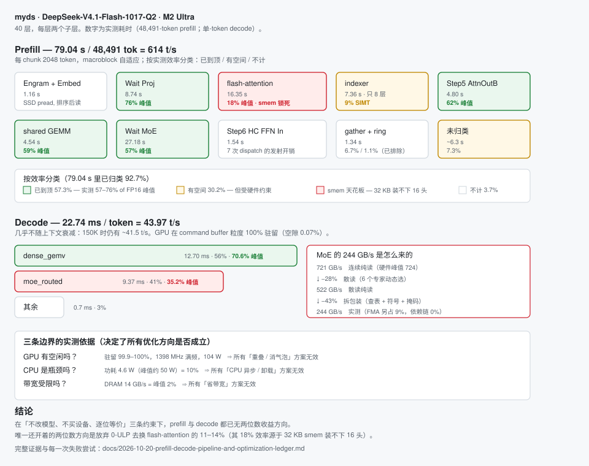

# myds: Apple Silicon Metal 推理引擎实验

> **来源与免责声明**：本项目**从 ds4 拷贝而来**，**全部内容由 LLM 编写**（DeepSeek / Gemini / Sol / Opus），
> 唯一目的是让它在 **M2 Ultra · 192 GB** 上更好用。
>
> *Origin & disclaimer: copied from ds4; wholly written by LLMs (DeepSeek, Gemini, Sol, Opus); just for better use on M2 Ultra / 192 GB.*

**当前 native engine 已完整实现 DeepSeek V4.1 文本计算图（HC、Engram、压缩 KV、indexer），并通过与 ds4 oracle 的逐位验收。**

验收依据与门禁规则记在性能账本的「方法论教训」与「已证否清单」两节；**性能现状、瓶颈归因与优化边界的唯一权威记录是 prefill/decode 全链路与优化账本，只读 §0.0（一页结论）即可掌握全部。** 单元测试通过不等于真实模型逐位对齐，改动数值路径仍须过同等门禁。

---

## 架构与耗时分布



一张图看完：40 层里每个子层的实测耗时、按效率的分色（绿=已到顶 / 黄=有空间但受约束 /
红=硬件天花板）、以及 decode 那 22.74 ms 的构成。**数字与[性能账本](docs/2026-10-20-prefill-decode-pipeline-and-optimization-ledger.md)一致，账本是唯一权威。**

---

## 实测性能

**硬件**：Mac Studio，M2 Ultra（76 核 GPU），**192 GB 统一内存**（Apple 标称；十进制 206 GB，Metal 可用上限 201.9 GB），带宽实测峰值 724 GB/s。
**模型**：DeepSeek-V4.1-Flash-1017-Q2，文件 362 GB，常驻 148.4 GB。
**口径**：独占整机、`temperature=0`、无并发，同一台机器上测得。重复测量的离散度见账本 §0.1（90K 四次：587.6 vs 中位 597.4，差 1.7%）。

### Prefill

| prompt | 8K | 32K | 90K | 150K | 200K | 400K | 500K |
|---|---:|---:|---:|---:|---:|---:|---:|
| **t/s** | 571.8 | **641.3** | 587.6 | 537.7 | 489.5 | 371.7 | 331.7 |
| TTFT | 14.0 s | 49.9 s | 153 s | 279 s | 409 s | 1076 s | 1507 s |

峰值在 **32K 附近**，之后随 attention 键数线性下降——这是算术强度的必然结果，不是实现低效。

### Decode

| prompt | 短 | 4K | 150K |
|---|---:|---:|---:|
| **t/s** | **43.97** | 41.30 | ~41.5 |

decode 几乎不随上下文衰减（97 倍上下文只掉 12.8%）：**长上下文的代价全在 prefill**。

### 关键边界：这里没有隐藏的余量

以 16.8K prompt = 26.3 s 为样本，三条「不是」决定了所有优化方向是否成立：

| 疑问 | 实测 | 含义 |
|---|---|---|
| GPU 有空闲吗？ | 驻留 **99.9–100%**，1398 MHz 满频，104 W | 所有「重叠 / 消气泡」方案无效 |
| CPU 是瓶颈吗？ | 功耗 **4.6 W**（峰值约 50 W）= 10% | 所有「CPU 异步 / 卸载」方案无效 |
| 带宽受限吗？ | DRAM **14 GB/s = 峰值 2%** | 所有「省带宽」方案无效 |

按实测效率普查，prefill 的 79 秒里 **57.3% 的块已在 57–76% 的 FP16 峰值**，
30.2% 有空间但受硬件约束（flash-attention 被 32 KB threadgroup memory 锁死），
3.7% 上界不足 2% 不值得做。完整分解、每一次失败尝试及其测量依据见
[性能账本](docs/2026-10-20-prefill-decode-pipeline-and-optimization-ledger.md)。

**本仓库诚实的结论**：在这台机器上，「不改模型、不买设备」的约束下，
prefill 与 decode 都已无两位数收益方向。

> **2026-10-25 修正**：原文此处写「剩下的路要么放弃 0-ULP 换 attention 的 11–14%，
> 要么换更大内存的硬件」。**前半句不成立。** 放宽 0-ULP 后逐条实测的子项：
> 专家进 grid.z **+0.82%**、专家权重截断 **+1.2%**、PLD 投机 **−6.6%**（倒亏），
> 其余子项需改模型或被明确排除。详见账本 §100/§101，
> 以及开关清单 [docs/ULP_SWITCHES.md](docs/ULP_SWITCHES.md)。
>
> 若将来要重启性能方向，应从**模型侧**入手（专家布局重排 / 分层量化 / KV 分层驻留），
> 而不是继续在 kernel 内找并发。

**一个反例值得记住**：本仓库真实拿到的最大提速（单份代码审计 20 min → 4.1 min，5 倍）
**不是来自内核优化**，而是修好了 `MYDS_PREFIX_CACHE` 的误用。这个项目的长期问题一直是
「配置声称的值 ≠ 实际生效的值」，而不是算力。

---

## 我们试过什么、为什么失败

**这一节比性能数字更有用。** 如果你打算优化这个引擎，先看这张表——这些方向已经有人用真实权重、真实 GPU 窗口测过了，
重复它们只会浪费时间。每一条后面都有明确的测量依据，细节在[性能账本](docs/2026-10-20-prefill-decode-pipeline-and-optimization-ledger.md)。

### MoE（14 个候选，全部未达标）

| 尝试 | 结果 |
|---|---|
| 内层 8 元素改 `dot(float4,float4)` | 微基准 **−3.69%**，但**非 0-ULP**，端到端 **−0.3%** |
| 拆分标量累加器 | **非 0-ULP**（浮点不结合），**−0.35%** |
| 专家地址重排（局部性） | **地址分布影响 0%**（散开 1.01×、半散 0.90×） |
| 每 simdgroup 2 行（`NR0=2/NSG=4`） | **+77.9%** ⇒ 每 simdgroup **必须** 4 行 |
| 5,248 B signed4 组合表 | 组件 **0-ULP 通过**，但耗时 **+20.5~21.0%** |
| 热专家缓存 | 384 个专家全在用（745 万次选择覆盖 100%），**无冷专家可跳**；且 SLC 对同址复用 **零收益** |

**MoE 的真实成本已量化**（三臂基准，同 dispatch 数、只差地址模式）：

```
721 GB/s  连续纯读（硬件峰值 724）
  ↓ −28%  散读（6 个专家动态选，物理不连续）
522 GB/s
  ↓ −43%  拆包装（LDS 查表 + popcount 符号 + 掩码取反 + int8→float）
  ↓ −9%   FMA
244 GB/s  实测
```

### CPU 异构（四类场景全测）

| 方向 | 结论 | 关键数字 |
|---|---|---|
| CPU 卸载 prefill MoE | **+1.7%**，不值得 | CPU 慢 GPU **31.2 倍** |
| CPU 卸载 decode engram_kv | **−5.6%** | CPU 同步阻塞 1.43 ms，GPU 那 0.62 ms 本就在气泡里 |

### Attention 与 dispatch（本轮 2026-10-24 普查）

| 方向 | 结论 |
|---|---|
| attention flash-decoding 拆两趟 | **−4.38%** |
| RMSNorm→GEMV 前序融合 | 证否 |
| 多头共享 K tile（H2/H4） | K-only 修订版 **0-ULP 通过**，但 concurrent 下退化 |
| 单头间接 KV 布局 | **0-ULP 通过**，但用时 **2.11 倍** |
| dispatch 边界气泡 | 实测 **intra_idle 17.3 µs = 0.07%**（GPU 在 command buffer 粒度 100% 驻留） |
| `simd_sum` 归约 / 屏障降级 | 组件 **0-ULP 通过**，indexer **−3.05%**，但 prefill **−0.18%（噪声内）** |

### 结构性封死（不是实现问题，是硬件或模型问题）

| 方向 | 阻断点 |
|---|---|
| flash-attention 提高每 TG 头数 | **32 KB threadgroup memory 装不下 16 头（需 60 KB）** ⇒ 18% 效率无法改善 |
| 换 FP8/BF16 主模型 | **统一内存墙**：FP8 需 ~510 GB，机器只有 192 GB |
| DSpark 投机解码 | 最好 **11.1%** 接受率 × 3.04× 验证成本 ⇒ **净慢** |
| 多请求合批 | 单人顺序请求**无货可合**，且生产有单飞锁 |
| TP=2 双机 | 需采购设备 |
| 抬线程数超 448 | 实测无变化（早期数字来自同时改 nsg 常量，口径错误） |

### 这一轮唯一采纳的改动

`MYDS_INDEXER_TILED=1`：indexer 颗粒度 128→256 对/TG，**prefill −1.73%**，
**5,987 个 logits 文件逐字节一致**（`nll_sum` 恒 `167.508180918`）。

---

## 已有算子与实验基础

- **围绕 DeepSeek V4 / V4.1 构建的算子基础**（已接入 V4.1 文本计算图）：
  - **RMSNorm** 归一化加速
  - **MLA (Multi-head Latent Attention)** 解耦多头潜在注意力与低秩压缩 KV Cache
  - **Decoupled RoPE** 解耦旋转位置编码
  - **DeepSeekMoE** 混合专家网络（Shared Experts 共享专家 + Top-K 路由专家，Sigmoid 门控与权重重整化）
  - **SwiGLU** 激活函数融合计算
  - **模型加载检查**：架构名称仅用于识别模型家族；另外检查必要操作和词表维度，遇到未实现的 HC、Engram、压缩 KV、indexer 会拒绝推理
- **Apple Silicon Metal 算子**：
  - 仓库包含从 `ds4` 迁移的 `.metal` 源文件；文件存在不代表相应模型步骤已接入计算图
  - 利用统一内存架构（Unified Memory）通过 `MTLResourceStorageModeShared` 实现 CPU 与 GPU 之间零拷贝
  - 运行时即时编译优化，原生发挥 M 系列芯片（M1/M2/M3/M4/M5 等）的最大能效
- **极简架构与近乎零依赖**：
  - 文本推理引擎仅由几个高内聚、低耦合的模块组成，不依赖外部第三方库（仅系统级 Foundation 与 Metal 框架）；
    视觉路径另用内置的 header-only `third_party/iris`（JPEG/PNG 解码，仅图片输入时用到）
  - 内置极简 GGUF v2/v3 解析器，支持 `mmap` 秒级映射大模型权重
  - 内置 merge-rank byte BPE、JoyAI 预分词、显式字节长度解码与 UTF-8 流式输出
  - `make` 构建本地程序与测试；另有独立 HF tokenizer 与 ds4 tensor 对照工具

### 一个不属于本仓库的运行时依赖

`tools/slim_dense_q4.py` （把 dense 权重从 Q8_0 压到 Q4_K）**需要 `libds4quants`**。
那个库是 Q4_K 量化内核的分发产物，不随本仓库发布，所以 **fresh clone 直接跑会报
找不到库**——这是预期行为，不是安装残缺。

两种供法：

```bash
# ① 显式指定
python3 tools/slim_dense_q4.py --in model-q8.gguf --out model-q4.gguf \
       --quants-lib /path/to/libds4quants.dylib

# ② 放到默认搜索位置之一
#   <repo>/ds4/gguf-tools/libds4quants.{dylib,so}
#   ~/Projects/ds4/gguf-tools/libds4quants.{dylib,so}
```

**没有纯 Python 回退实现**：Q4_K 的分块量化必须与推理内核逐位一致，
用 numpy 重写一遍只会得到“看起来对但和 kernel 不同”的权重。
报错信息会把所有搜索路径与两种供法都打出来。

---

## 项目结构

```
myds/
├── Makefile                          # 极简构建规则 (make, make test, make clean)
├── README.md                         # 项目设计与使用文档
├── metal/                            # 迁移自 ds4 的 Metal 核心 Shader（共 24 个）
│   ├── argsort.metal                 # Top-K 路由排序
│   ├── bin.metal                     # 标量与张量二元计算
│   ├── concat.metal                  # 张量拼接
│   ├── cpy.metal                     # 快速连续内存与格式转换
│   ├── dense.metal                   # 量化 GEMV/GEMM (Q8_0, Q4_K, Q2_K, F16, F32)
│   ├── dsv4_hc.metal                 # HC 多路残差（split / sinkhorn / 加权和 / RMSNorm）
│   ├── dsv4_kv.metal                 # DeepSeek KV Cache 状态操作
│   ├── dsv4_misc.metal               # DeepSeek 辅助算子
│   ├── dsv4_rope.metal               # 解耦 RoPE 旋转位置编码
│   ├── dsv41.metal                   # V4.1 专有算子（indexer / compressor / attention-out）
│   ├── flash_attn.metal              # flash attention 核心（含 packed8 归约）
│   ├── get_rows.metal                # 嵌入层查表操作
│   ├── glu.metal                     # SwiGLU 激活函数
│   ├── moe.metal                     # 量化 MoE 专家 GEMV / 路由 / 累加（iq2_xxs, q2_K, q4_K …）
│   ├── myds_chunk.metal              # 分块 prefill 的 chunk attention / compressor
│   ├── myds_v41_moe.metal            # V4.1 shared-expert gate/up/SwiGLU 融合算子
│   ├── norm.metal                    # RMSNorm 算子
│   ├── repeat.metal                  # 广播重复
│   ├── set_rows.metal                # 行级写入
│   ├── softmax.metal                 # Softmax 与缩放
│   ├── sum_rows.metal                # 行求和归约
│   ├── topk_threshold.metal          # top-k 阈值筛选
│   ├── unary.metal                   # 一元运算
│   └── visenc.metal                  # 视觉编码器算子
├── include/                          # 头文件定义（共 24 个）
│   ├── myds.h                        # 推理引擎主接口与 V4/V4.1 架构判定
│   ├── myds_internal.h               # 引擎内部共享
│   ├── myds_metal.h                  # Metal GPU 运行时与算子声明
│   ├── myds_gguf.h                   # 极简 GGUF 格式解析器
│   ├── myds_tokenizer.h              # DeepSeek BPE 分词器
│   ├── myds_server.h                 # HTTP 服务端
│   ├── myds_server_internal.h        # HTTP 服务端内部
│   ├── myds_log.h                    # 微秒级线程安全结构化日志
│   ├── myds_cpu.h                    # CPU 算子
│   ├── myds_align.h                  # 对齐工具
│   ├── myds_v41.h / _decode.h / _gpu.h / _moe.h   # V4.1 计算图 / decode / GPU / MoE
│   ├── myds_engram.h                 # Engram 表读取
│   ├── myds_kvdsk.h                  # 低位 KV 磁盘缓存
│   ├── myds_lowkv_policy.h           # 低位 KV 策略
│   ├── myds_snapshot_slots.h         # 内存前缀快照槽位
│   ├── myds_dspark.h / myds_pld.h    # 投机解码 / PLD
│   └── myds_vispre.h / _visw.h / _visfwd.h / _vjob.h   # 视觉：预处理 / 权重 / 前向 / 作业
├── src/                              # 核心源码（共 19 个）
│   ├── main.c                        # 命令行与交互终端入口
│   ├── myds_engine.c                 # 前向传播流程、模型加载与投机解码调度
│   ├── myds_cpu.c                    # CPU 数值算子（复用 RoPE 角度计算）
│   ├── myds_metal.m                  # Metal 运行时与 GPU 算子分发
│   ├── myds_gguf.c                   # GGUF 格式解析与 mmap 内存映射
│   ├── myds_tokenizer.c              # BPE 编码与流式解码
│   ├── myds_server.c                 # POSIX HTTP Server (OpenAI Responses / Chat)
│   ├── myds_log.c                    # 结构化日志实现
│   ├── myds_v41.c                    # V4.1 文本计算图（HC / 压缩 KV / indexer）
│   ├── myds_v41_decode.c             # V4.1 decode 路径
│   ├── myds_v41_gpu.c                # V4.1 GPU 算子与 PSO 组合
│   ├── myds_v41_moe.c                # V4.1 MoE 路由与派发
│   ├── myds_engram.c                 # Engram 表读取与并行 pread
│   ├── myds_kvdsk.c                  # 低位 KV 磁盘缓存
│   ├── myds_dspark.c                 # DSpark 投机解码
│   ├── myds_vispre.c                 # 视觉：图片解码 / 预处理 / token 布局
│   ├── myds_visw.c                   # 视觉：编码器权重加载
│   ├── myds_visfwd.c                 # 视觉：编码器前向
│   └── myds_vjob.c                   # 视觉作业
└── tests/                            # C 单元/回归测试（39 个）+ 少量 Python 门禁
    ├── test_gguf.c  test_tokenizer.c  test_engine.c  test_cpu.c  test_log.c  test_align.c
    ├── test_metal.c  test_v41_gpu.c  test_attention_vec.c  test_attention_policy.c
    ├── test_qkv_fusion.c  test_decode_q8_contract.c  test_v41_router.c  test_moe_shared3.c
    ├── test_engram.c  test_engram_pool_failures.c  test_kvdsk.c  test_deeper_ssd.c
    ├── test_server.c  test_server_api.c  test_http_bytes.c
    ├── test_batch2_e2e.c  test_batch2_parity.c  test_batch2_shared_swiglu_pair.c
    ├── test_tree_spec.c  test_pld.c  test_engine_depth2.c  test_depth2_shared_swiglu_shared3.c
    ├── test_dspark_rollback.c  test_dspark_capture.c  test_dspark_router.c
    │   test_dspark_moe.c  test_dspark_attention.c  test_dspark_proposal.c
    ├── test_p1_regressions.c  test_kprof.c  test_metal_residency_lifecycle.c
    └── test_teardown_order.c  test_visw.c
    # Python 门禁：tests/test_http_bytes.py、tests/test_bench_reproduce.py、tests/test_engram_io_window.py 等
```

---

## 编译与测试

历史优化轮次的验收结果摘要（每轮均为同构建完整模型 A–B–A、短/800-token 业务输入）：

| 轮次 | 内容 | decode 变化 |
|---|---|---|
| 2026-10-13 | Router SIMD shuffle、attention register、Q2 固定形状三个原生候选 | **−1.87% / −2.03%** |
| 2026-10-14 | 上述组合部署上线后的复验 | **−1.85% / −1.98%** |

更早的 Q2 down 独立 NSG、top-k 前缀合并裁剪、NaN 分类融合、Batch2 output-B Q8 双输入共享权重
等候选，结论均已并入[性能账本](docs/2026-10-20-prefill-decode-pipeline-and-optimization-ledger.md)的
已采纳 / 已证否两节——**该账本是性能结论的唯一权威，本 README 不重复维护这些数字。**

测试关闭 profiler、内存前缀命中和 KV 磁盘命中，每组预热一次后正式运行三次。
prefill 按实际处理的输入 token 计时，decode 按首次到末次输出回调之间的 token 间隔计时。
基准固定 `temperature=0`、`top_p=1`、`top_k=0`、`min_p=0`、
`repetition_penalty=1`、`seed=42`；greedy argmax 路径不读取采样随机数。
长输入的耗时波动与「无 GPU 额外提交」的路径诊断当时另有补充验证，测到过两轮变慢；
原始数据保留在证据包里，**不把复测的稳定收益当作所有运行的保证**。
2026-09-29 的早期性能记录只作历史状态说明，**已明确不代表可用性能**，不作基线。
当前基线与边界见性能账本 **§0.0**。

### 1. 编译项目

在项目根目录下直接运行：

```bash
make
```

将在 `bin/` 目录下生成 `myds` 主程序以及独立的测试程序。

### 2. 运行单元测试套件

```bash
make test
```

测试流程将自动编译并依次运行单元测试套件，包含下列基础测试以及
Engram、KV 磁盘存储、前缀恢复、V4.1 GPU 和 HTTP 字节输出回归：

1. **GGUF 模型解析器测试套件 (`bin/test_gguf`)**：
   - [x] GGUF v2/v3 标量、字符串、布尔及动态数组元数据提取
   - [x] 张量描述信息校验与 32 字节对齐 mmap 内存映射验证
   - [x] 非法魔数（Magic）、损坏文件及不存在文件的容错处理
   - [x] **DeepSeek V2 & V3 架构拦截校验**（严格拒绝 legacy V2/V3 模型）

2. **DeepSeek BPE 分词器测试套件 (`bin/test_tokenizer`)**：
   - [x] 词表加载与 BOS/EOS 特殊 Token 识别
   - [x] Byte BPE 映射、merge rank、JoyAI 预分词与已知答案
   - [x] Byte-Fallback `<0xHH>` 未登录字节回退处理
   - [x] 逐 Token 还原文本与字节 Token 还原
   - [x] 缺失词表时的 256 字节兜底模式验证

3. **Metal GPU 核心算子测试套件 (`bin/test_metal`)**：
   - [x] **RMSNorm** 算子（与 CPU 基准对齐，浮点误差 < 1e-4）
   - [x] **SwiGLU** 激活函数（与 CPU 基准对齐，浮点误差 < 1e-4）
   - [x] **Decoupled RoPE** 解耦旋转编码（旋转前后向量模长守恒）
   - [x] **DeepSeek-MoE Router** 专家路由（Sigmoid 门控打分、Top-K 选取与权重重整化）
   - [x] **GEMV F32** 浮点矩阵向量乘法
   - [x] **GEMV Q8_0** 量化反量化点积精度测试
   - [x] **DeepSeek-MoE Sum** 多专家加权累加测试
   - [x] **Add** 残差加法与广播
   - [x] **Softmax** 归一化与单调性校验
   - [x] **Buffer R/W** 统一内存边界读写安全测试

4. **HTTP 服务器并发测试套件 (`bin/test_server`)**：
   - [x] Socket 生命周期与 HTTP 报文收发
   - [x] 并发非阻塞请求测试

5. **微秒级结构化日志测试套件 (`bin/test_log`)**：
   - [x] 日志级别过滤 (DEBUG / INFO / WARN / ERROR)
   - [x] 多线程并发无锁写入安全性测试

6. **OpenAI Responses API 协议测试套件 (`bin/test_server_api`)**：
   - [x] 端点路由匹配 (`/responses`, `/chat/completions`, `/health`, `/models`)
   - [x] 复杂输入参数优先级解析 (`max_output_tokens` 优先于 `max_tokens`)
   - [x] Responses API 流式 SSE 事件与非流式 JSON 响应规范金标对齐

7. **推理引擎采样与架构判定测试套件 (`bin/test_engine`)**：
   - [x] Greedy Argmax / Temperature / Softmax / Top-p 采样算法测试
   - [x] **DeepSeek V4/V4.1 架构专有支持与 V2/V3 拦截测试**（`myds_is_supported_arch`）
   - [x] Prefill 工作区扩容/复用、跨 512-token 边界、取消与恢复、KV 容量检查

8. **CPU 数值回归 (`bin/test_cpu`)**：
   - [x] RoPE 在 288 组形状/位置/缩放/正反向组合下与原实现逐位一致
   - [x] 逆旋转还原、无旋转及非法形状边界

运行可复现的算子与合成模型基准：

```bash
make bench
```

其中 `bench_metal` 在同一进程比较逐 token 与批量 GEMV，并检查逐位一致；
`bench_synthetic` 生成小型 MLA + MoE GGUF，测量真实加载、预填充和解码路径。
合成模型用于验证调度开销，真实模型性能请使用 `tools/bench.sh` 或 HTTP 基准。

---

## 快速上手

### 命令行生成

以下展示 CLI 接口：

```bash
./bin/myds -m /path/to/deepseek.gguf -p "你好，请介绍一下你自己。"
```

### 交互式对话模式

如果未指定 `-p` 参数，`myds` 会自动进入交互式对话模式：

```bash
./bin/myds -m /path/to/deepseek.gguf
```

### HTTP 服务器模式 (OpenAI 兼容 API)

`myds` 内置 POSIX HTTP 服务端。只有模型加载通过后才会启动监听：

```bash
# 默认只监听 127.0.0.1（服务端没有鉴权）。
./bin/myds -m /path/to/deepseek.gguf --port 8080 --alias myds

# 要对外提供服务，必须显式指定 --host，并在前面放一层带鉴权的反代：
# ./bin/myds -m ... --port 8080 --host 0.0.0.0 --alias myds
```

> ⚠️ `--host` 只接受 IPv4 点分十进制地址（`127.0.0.1` / `0.0.0.0` / 具体网卡 IP）。
> 传主机名（如 `localhost`）会**拒绝启动**——旧版会默默退回监听全部接口。

支持的标准端点：
- `GET /health`：服务健康检查
- `GET /v1/models`：获取已加载的模型列表
- `POST /v1/responses` 或 `/responses`：原生支持 OpenAI Responses API 格式，完整支持流式 SSE (`event: response.output_text.delta`, `response.completed` 等) 与非流式 JSON (`output` 消息数组)
- `POST /v1/chat/completions` 或 `/chat/completions`：支持标准 OpenAI Chat Completions 协议（流式 SSE 与非流式 JSON）
- 请求体参数兼容性：全面支持 `instructions`（系统指令）、`input`（消息数组或纯文本，自动展开 `input_text` 复杂结构）、`messages`、`max_output_tokens` / `max_tokens`、`temperature` 与 `top_p`

### 常用参数说明

```
Usage:
  ./bin/myds -m <model.gguf> [options]

Options:
  -m, --model <path>      Path to DeepSeek GGUF model (required)
  --port <port>           Run HTTP server on specified port
  --host <host>           Host to listen on (default: 127.0.0.1; no auth, use a proxied 0.0.0.0 only)
  --alias <name>          Model alias for API responses (default: myds)
  -p, --prompt <string>   Prompt string (if omitted and no --port, starts interactive chat)
  -n, --max-tokens <int>  Max tokens to generate (default: 256)
  -c, --ctx, --ctx-size   Context window size (default: 4096)
  --temp <float>          Sampling temperature (default: 0.7, 0.0 for greedy)
  --top-p <float>         Nucleus top-p sampling cutoff (default: 0.9)
  --seed <int>            Random seed (default: random)
  -h, --help              Show this help message
```

### 服务端防护与隐私（2026-10-25）

服务端**没有任何认证**，默认只监听 `127.0.0.1`。要对外提供服务，请放在带鉴权的
反向代理之后，并显式指定 `--host`。

| 环境变量 | 默认值 | 行为 |
| --- | --- | --- |
| `MYDS_MAX_BODY_MB` | `8` | 请求体上限（MB，取值 1..1024）。超限直接返回 **413**，不分配内存。旧版按 `Content-Length` 原样 `realloc`，一条 `Content-Length: 10000000000` 即可要求分配 10 GB。 |
| `MYDS_MAX_CONN` | `256` | 并发连接上限（1..4096）。超限返回 **503**。每条连接固定 4 MB 栈，无上限时几百条空闲连接即可耗尽内存。 |
| `MYDS_RECV_DEADLINE_S` | `120` | **整体**接收截止时间（秒，5..3600）。`SO_RCVTIMEO` 只管单次 `recv`，每 29 秒滴一个字节就能无限拖延；超时返回 **408**。 |
| `MYDS_CORS_ORIGIN` | `*` | 未设或 `*` 保持旧行为；`none` 不发送任何 CORS 头；其他值原样回显为该 origin。`CORS` 不是安全边界，真正的防护是监听地址与鉴权。 |

**启动时会把 fd 上限提升到 4096**（不超过系统硬限制）。`accept` 遇到 `EMFILE`
只退避 50 ms 后继续，不再退出服务器——旧版会把任何客户端开满 fd 当成致命错误。

#### ⚠️ 提示词会明文落盘

为了跨重启续跑 `previous_response_id`，服务端会把**完整的累积提示词文本**以
**明文**写入 `$HOME/.cache/myds/responses.idx`（可用 `MYDS_RESP_STATE` 改路径）。
文件权限为 `0600`、所在目录为 `0700`，但**未加密**。

这意味着你发过的全部对话内容会留在磁盘上，可能包含代码、密钥和个人数据，
并会被备份工具一并带走。不接受这一点的话：把 `HOME` 指向临时目录、
定期删除该文件，或让客户端不用 `previous_response_id`（每轮重发完整历史）。

### V4.1 推理工作区与流式传输

chunk attention 的 KV slab 和 mask 初始只分配窗口路径所需的 10.625 MiB。
压缩键容量仍覆盖配置的上下文；走 dense slab 且现有工作区不足时才扩容。
内存前缀快照在首次捕获对应槽位时分配，已分配的槽位继续复用。
compressed KV 与 index cache 保存已完成 BF16 舍入的上 16 位，读取时还原 F32；
计算中间量保持原精度与归约顺序。

| 环境变量 | 默认值 | 行为 |
| --- | --- | --- |
| `MYDS_ATTN_GATHER_MIN_KEYS` | `0` | scratch 创建时捕获。压缩键数小于阈值时走 slab，达到阈值时在 gather 已启用且提供缓冲的条件下走 gather。合法范围为 `0..chunk_key_max`；非法值会拒绝工作区创建。阈值须按本机与负载测量。 |
| `MYDS_ATTN_GATHER` | 启用 | 设为 `0` 关闭 gather，阈值不覆盖此开关。 |
| `MYDS_ATTN_VEC_HEAD_FIRST` | 启用 | gathered prefill 的 vec attention 将 query/head 物理 grid 调换，保留每个 head 的算术与归约。设为 `0` 使用原排列。旧 metallib 缺新 PSO 时自动回退，并在 scratch 中缓存不可用状态；首次回退输出一条 WARN 日志，进程级计数可由 `myds_v41_gpu_attention_counters()` 读取。 |
| `MYDS_PREFILL_ATTN` | `vec` | `matrix` 与 `auto` 是 compressed gather 的实验选项。矩阵归约会产生浮点差异，实测长输入生成 token 可变化；默认关闭。`auto` 的矩阵 PSO/共享内存不可用时回退 vec，显式 `matrix` 则返回失败。 |
| `MYDS_PREFILL_INDEXER_PEEL` | 启用 | ratio=2 的索引层在绝对位置 0 保留没有可见压缩键的首行，其余行继续批处理，避免整个首块回退逐 token。首行 Q、selected 和 mask 保持不变；设为 `0` 恢复原回退路径。 |
| `MYDS_PREFILL_SKIP_DEAD_KV` | 启用 | 后缀收缩时，跳过第 21–39 层中已经不需要保留窗口 KV、且没有压缩器工作的前缀块。保留原 chunk 边界、近端窗口、carry 和有效快照；trace 保留原路径。设为 `0` 恢复原归一化与调度。 |
| `MYDS_PREFILL_SHRINK_GRID_GUARDED` | 启用 | 按实际可发布的 512 网格快照收紧后缀重算范围，并保留原 KV 分块边界和 MM/GEMV 数值路径。仅在 chunk=512、shift=512、非别名 MoE 累积区可容纳完整 macroblock、默认 MoE MM 阈值、dedup 关闭且 attention 为 vec／gather-min=0 时采用；其他配置与 trace 使用原路径。`0` 恢复原重算范围。 |
| `MYDS_PREFILL_SHORT_END_SNAPSHOT` | 启用 | prefix cache 开启时，当 prompt 末尾位置 `p=prompt_tokens-1` 为 4–1023 时保存 RAM slot 0，使完全重复的短请求直接恢复 prompt-end 状态。周期与 SSD 快照仍从 1024 开始；额外 RAM 约 10 MiB。`0` 关闭短末尾快照。 |
| `MYDS_QKV_FUSE_BF16` | 启用 | decode 的 Q8 QKV 投影把 BF16 舍入合并到 GEMV 写出；设为 `0` 恢复独立舍入 dispatch。trace 使用原路径。 |
| `MYDS_QKV_FUSE_POST` | 启用 | decode 合并 Q/K RoPE、KV 量化及窗口写入，保留原舍入边界；设为 `0` 恢复原 dispatch。缺融合 PSO、别名或 copy 故障注入时回退原路径。 |
| `MYDS_QKV_NR0` | `4` | 融合 Q8 GEMV 每组处理四个独立输出行；`2` 使用两个行的配置。归约顺序不变。 |
| `MYDS_LM_HEAD_Q8_NR0` | `2` | 初始化时读取，严格接受 `2` 或 `4`；未设置时保留原路径。显式 `4` 在单 token、输出维度大于 65536 的 plain Q8_0 GEMV 中，每组处理四个独立输出行，保留 NSG8、原逐行 K 遍历/归约与完整 F32 logits。缺候选 PSO 时初始化失败并清理；候选 dispatch 失败返回错误。验收与当前采用状态见 LM-head 验证报告。 |
| `MYDS_BATCH2_SPEC` | 关闭 | 显式 `1` 请求 greedy、无图片的真实 batch2；剩余输出/context 至少两步，DSpark 主候选仍要求 high-confidence。 |
| `MYDS_BATCH2_Q8_SHARED` | `0` | 严格接受 `0` 或 `1`。显式 `1` 在 eligible Batch2 output-B Q8/BF16 投影中，让两个 token 复用同一量化权重读取，保留各自的累加、归约和舍入。trace、关闭原 decode BF16 fusion 或其他投影保持参考路径；缺候选 PSO 时初始化失败。需与真实 Batch2 整图计数和完整模型 A–B–A 一起验收。 |
| `MYDS_SPEC_SERIAL_PROBE` | 关闭 | 显式 `1` 允许 V4.1 逐 token 验证的 DSpark/PLD 对照；默认未启用 batch2 时跳过这类草稿与快照工作。 |
| `MYDS_SPEC_COST_SCHEDULER` | 关闭 | 显式 `1` 按整个周期成本与纯 target 基线比较，三个不划算周期后 backoff 16 个候选周期；每请求重置，需独立 A/B。 |
| `MYDS_DECODE_METRICS` | 关闭 | 显式 `1` 收集 host 分项时间与原始周期；请求 counters 始终可读。成本调度器也启用累计计时，但不会单独开启原始周期数组。 |
| `MYDS_QKV_CONCURRENT` | 关闭 | 显式设为 `1` 才在单 token QKV/Indexer 局部图创建 concurrent encoder，按资源同步独立分支；正常退出与失败都恢复进入前的 encoder/auto-barrier 设置。trace 与关闭 QKV pipeline 时保留参考路径。已有 `MYDS_METAL_CONCURRENT=1` 仍有原全局语义。 |
| `MYDS_INDEXER_COMPACT_SCORER` | 关闭 | 显式设为 `1` 才在单 token decode 的 layer 24/28/32/36、历史行数超过 16384 时，按 layer 20 原 selected block IDs 派发评分。先填充 dense scores 为 `-INFINITY`，有效行写回原 ID；原 filter 与 dense top-k 分区/同分网络保持一致。缺可选 PSO 在写入前回退；开始派发后失败终止。prefill、trace 与批量投机保持参考评分路径。 |
| `MYDS_INDEXER_TOPK_PREFIX_MERGE` | `0` | 显式 `1` 在至少 16 个原排序分区、`top<=512` 的原 eligibility 内裁剪中间 merge 输出。保留原 partition 与比较网络；含可见 NaN 的行使用 dense merge。 |
| `MYDS_INDEXER_TOPK_NAN_FUSE` | `0` | 严格接受 `0` 或 `1`。同时开启 prefix merge 时，在原 sorter 中按 IEEE 位分类每个分区，替代独立分类 dispatch；空/future causal 分区明确写零。缺可选 PSO 或几何不支持原 `nth` 时，在写入前回退 dense。counter 表示 host 编码，不能当作实际 GPU 流量。 |
| `MYDS_MOE_IQ2_TAIL_CULL` | 启用 | prefill MoE IQ2 up/gate 的尾 tile 跳过没有有效 token 的半 tile。`0` 恢复原 kernel；默认缺新 PSO 时回退原 kernel，显式 `1` 缺 PSO 时初始化失败并清理所有部分状态。 |
| `MYDS_SSE_DRAIN_TIMEOUT_MS` | `1000` | SSE 完成时的整体排空期限，合法范围 `1..30000` ms；非法值使用默认值。 |

两项 decode 实验均默认关闭。本地 M4 的非零组件检查验证 QKV/HC/Indexer 中间量、
有效与屏蔽行分数及原 top-k IDs 逐位一致；Mac Studio 普通输入的 QKV A–B–A 未见额外收益，
完整结果和配置见上述实测报告。
compact scorer 只减少屏蔽行的空 threadgroup，并增加一次 dense `-INFINITY` 填充；
它仍扫描原 dense top-k，不能承诺 top-k 加速。采纳前分别测量实际 GPU 重叠及
长上下文整模型 A–B–A，报告路径计数、fallback、数值/状态回归和 P95/P99；本轮128k仍未测量。
`myds_v41_gpu_indexer_compact_counters()` 提供请求、实际派发、缺 PSO 回退、dense 行数及
实际派发行槽数，避免把请求开关当作已执行路径。

生产 SSE 输出使用每请求独立的 FIFO writer。队列上限为 1 MiB，包含包头和正在发送的包；
入队不等待客户端 socket 或空闲队列容量。积压超限或断连会取消该请求，socket 在 writer
退出并 join 后关闭。尾部排空目前仍持有推理槽，等待受上述整体期限限制。

低位 KV 磁盘缓存改为窗口快照加共享 BF16 段：第一段为 `[0,1024)`，后续每段 512 token。
窗口文件为 `kvlow-v3-<identity>.bin`，段文件为 `kvsegments-v1-<identity>.bin`，
二者的总文件容量共同计入 `MYDS_KV_DSK_BUDGET_MB`。旧格式文件不再复用，也不会自动删除。
快照仅在相关段提交后发布；恢复校验位置、前缀哈希、布局和完整 payload 校验和，
引用的段被覆盖或损坏时返回缓存 miss。相同内容再次保存不重写窗口或共享段，但仍读取
并校验已有段。此存储改动不改变 `MYDS_KV_DSK_ASYNC` 的默认开关。

针对这些改动的本地门禁为 `make test`。V4.1 GPU 回归分别运行默认 gather、关闭 gather、
显式阈值三种配置，并覆盖同一 command batch 内的路径切换、工作区扩容和 BF16 缓存对照。
这些测试不替代真实 GGUF 模型的 logits、吞吐与 TTFT 验收。

`make test` 还包含 QKV 两种行配置的非零逐位对照，以及 attention 的短块、carry、
F32/BF16 输入、子视图 canary、同一 batch 混用和缺 PSO 回退。独立完整模型计时工具
可用 `make bin/bench_phase` 构建；它不会由默认测试自动加载模型。

### 2026-10-05 测试、日志与测量复现

> **证据包不在本仓库。** 下文的 `$MYDS_EVIDENCE` 指向独立分发的原始测量证据（冻结的请求、补丁、
> 日志与汇总脚本），体积为数 GB，未随源码发布。不设该变量时，所有依赖它的步骤可跳过；
> 本仓库自带的 `tools/bench_reproduce.py` 与 `make test` 不依赖它。

本轮完整模型实测机器是 Apple M2 Ultra / 192 GiB / macOS 26.5.2，模型为
`DeepSeek-V4.1-Flash-Q2.gguf`，上下文容量 262144。本地 Apple M4 / 16 GiB
运行小规模 GPU fixture 和单元测试；完整模型吞吐数据来自 Mac Studio。
需要 Python 3、Clang、macOS SDK 和 Metal 编译工具；项目的
`tools/build_metallib.py` 负责生成 metallib。完整模型复测需要本机准备相同 GGUF。

#### 单元测试与日志

从仓库根目录运行，保存 stdout/stderr，并通过 `pipefail` 保留测试失败状态：

```sh
MYDS_REPRO_OUT="$(mktemp -d /tmp/myds-review-XXXXXX)"
set -o pipefail
make -B -j8 all bin/bench_phase 2>&1 | tee "$MYDS_REPRO_OUT/build.log"
make test 2>&1 | tee "$MYDS_REPRO_OUT/unit-tests.log"
make test-tail-init 2>&1 | tee "$MYDS_REPRO_OUT/tail-init.log"
python3 tools/protocol/selftest-summarize-final.py \
  > "$MYDS_REPRO_OUT/measurement-audit-selftest.json"
python3 tools/bench_reproduce.py verify
# 仅在基准测量快照检出上：python3 tools/bench_reproduce.py verify --check-source
```

`make -B` 强制重编译，避免复制源码或切换测量版本时复用时间戳较新的旧对象文件。
`make test-tail-init` 是独立 GPU 测试，不由 `make test` 自动执行；
`make build-tail-init` 只构建缺少可选 tail PSO 的真实 metallib fixture。
测量汇总脚本的 selftest 只处理 CPU 数据，验证有效样本及 18 种错误记录的拒绝行为。

| 测试入口 | 主要断言 |
| --- | --- |
| `bin/test_v41_gpu`、`--slab`、`--threshold` | gather/slab 选择、阈值、lazy 工作区、BF16 缓存、同一 batch 内路径切换；compact scorer 在 1..128k 行比较 dense scores/原 top-k IDs，覆盖全允许/屏蔽、有限及 `-INFINITY` 同分、尾块、反序 block IDs、子视图 canary、concurrent 依赖和缺 PSO 未写入回退；三种配置均在 `make test` 中执行。 |
| `bin/test_attention_policy` | matrix/auto/vec 策略、缺 PSO 和共享内存失败回退、恢复后的重试。 |
| `bin/test_attention_vec` | 非零 F32/BF16 逐位对照、短块和 carry、子视图 canary、head-first 成功与缺 PSO 回退及对应路径计数。 |
| `MYDS_QKV_NR0=4 bin/test_qkv_fusion`、`MYDS_QKV_NR0=2 bin/test_qkv_fusion` | 两种独立行配置、BF16 舍入边界、RoPE/量化/窗口写入、奇数输出行、别名与 copy 失败回退；局部 concurrent scope 比较实际投影形状的 QKV/HC/32-head Indexer，验证 opt-in/trace 门禁及失败后恢复两种设置；均在 `make test` 中执行。 |
| `make test-tail-init` | 真实缺 tail PSO 和必需 PSO 创建失败后的全状态清理、重复失败、恢复完整库及 lazy 初始化重试。 |
| `bin/test_engine`、`bin/test_p1` | 生成、前缀恢复与快照边界、缓存失败路径回归。 |
| `bin/test_server_api`、`tests/test_http_bytes.py` | FIFO SSE 输出、背压/断连取消、排空期限与实际 HTTP 字节协议；由 `make test` 执行。 |
| `bin/test_engram`、`bin/test_kvdsk`、`bin/test_metal` | LUT 数值、共享段提交/覆盖/损坏/budget、Metal 特化缓存与基础算子。 |
| `python3 tests/test_bench_reproduce.py` | 全 CPU：使用保存的真实 metrics 验证汇总，用 subprocess stub 验证输入/日志绑定、非 greedy 拒绝、超时/失败清理；由 `make test` 执行，stub 不运行 GGUF 或 Metal。 |

本轮原始日志收录于 `$MYDS_EVIDENCE/benchmarks/2026-10-05-optimization/validation/`：
`workspace-build.log`、`workspace-test.log`、`workspace-tail-init-test.log`、
`workspace-policy-retry-test.log`。`mandatory-pso-before-test.log` 是修复前故障复现，
其失败是预期证据；`mandatory-pso-after-test.log` 是修复后的通过记录。
打包时新增的测量入口 CPU 回归单独记录在 `reproduction-tool-test.log`，
探针构建与补丁检查记录在 `replay-tools/cpu-validation.json`。
本地 fixture 通过的范围是这些断言，完整模型的输出与性能另由下面的工具验证。

#### 完整模型每 token 测量

先在 Mac Studio 安排独占窗口：确认生产请求结束，暂停推理服务和其他 GPU benchmark，
完成后重启推理服务并检查 `/health`。
`tools/bench_reproduce.py run` 会检查已知推理/benchmark 进程与默认端口监听，
发现仍在运行时退出；服务暂停与恢复由窗口管理者负责。

```sh
MYDS_REPRO_MODEL="$HOME/.lmstudio/models/antirez/deepseek-v4.1-flash-gguf/DeepSeek-V4.1-Flash-Q2.gguf"
python3 tools/bench_reproduce.py run \
  --binary "$PWD/bin/bench_phase" \
  --model "$MYDS_REPRO_MODEL" \
  --request "$MYDS_EVIDENCE/benchmarks/2026-10-05-optimization/requests/normal.json" \
  --out "$MYDS_REPRO_OUT/candidate-normal"
```

输出目录必须是新的。`run-metrics.jsonl` 保存 metadata、模型加载信息、预热和三轮正式样本，
包括实际 token 数、原始 token 数组、输出字节哈希、逐 token 回调间隔；
`run.log` 保存引擎 stdout/stderr；`run-state.json` 保存完整 argv、显式环境、
二进制/metallib/请求 SHA、模型文件大小与 mtime、运行前后硬件/内存/swap 状态及退出码；
`run-summary.json` 仅在样本校验通过后产生。模型身份记录为文件元数据，未对整个 GGUF 做 SHA。
metadata 的 environment 额外记录 `MYDS_ATTN_VEC_HEAD_FIRST`、`MYDS_ATTN_GATHER_MIN_KEYS`、
`MYDS_PREFILL_ATTN`、`MYDS_QKV_FUSE_BF16`、`MYDS_QKV_FUSE_POST`、`MYDS_QKV_NR0`、
`MYDS_MOE_IQ2_TAIL_CULL`。每个样本含 `attention_paths`（本轮 attention 调用、gather/slab、
head-first 尝试/成功/失败/缓存回退、原 vec、matrix 及其回退次数）；出现回退时 stderr 另有一行提示。
Engram I/O 配置另记录 `MYDS_ENGRAM_IO_THREADS`、`MYDS_ENGRAM_NOCACHE`。
直接调用底层工具时，`MYDS_BENCH_STORAGE_COUNTERS=1` 在每次请求计时前后记录
`IOBlockStorageDriver` 的全局计数器；采集时间不计入请求耗时。这些是操作系统块设备
读计数，不能单独归因到本进程，也不能当作 NAND 流量。
`run-summary.json` 与 `compare` 输出 `attention_paths`，`run` 结束时打印 `attention_fallback`。
2026-10-05 证据由加入这些字段之前的 bench_phase 生成，样本中没有该字段，汇总显示为 `null`。

入口清除全部继承的 `MYDS_*` 环境，并显式设置 prefix cache、KV disk、phase profiler 为 0，
chunk=512、MoE chunks=9、suffix shift=512、residency keep-alive=86400。
`--env MYDS_NAME=value` 可以重复传入，例如 `--env MYDS_ATTN_VEC_HEAD_FIRST=0`；
缓存命中、profiler 和跳过计算的配置会被拒绝。三个请求样本为
`requests/short.json`、`normal.json`、`long.json`，分别实测 prefill 356、1830、7194 token。
默认生成上限 64；短请求实际 EOS 为 26 token，decode 分母因此为 25。

底层工具也可以直接调用：
`bin/bench_phase model.gguf request.json [repeats=3] [max_new_tokens=64] [max_seq_len=262144]`。
输出上限支持 32/64；温度、top-p、top-k、min-p、重复惩罚和 seed 在工具中固定为
0/1/0/0/1/42，greedy 路径不读取采样 RNG，请求 JSON 中的 sampling 字段不覆盖它。
prefill 口径为 `1000 * prefill_seconds / prefill_tokens`，最终 prompt token 在首次 decode
forward 消耗；decode 为 `1000 * (last_callback-first_callback) / (output_tokens-1)`，
不含首次 forward/TTFT。加载、HTTP 传输、队列等待不计入这两个指标。

#### Engram SSD 并行读取

默认使用 8 个读取线程；`MYDS_ENGRAM_IO_THREADS=1` 使用原串行读取；`2..16` 使用每个 context 独立拥有的
常驻线程池。只并行当前 token 的两张表共 48 行 raw `pread`，解码仍在调用线程按
原顺序执行。全部 worker 结束、读取与解码全部成功后才提交 history/position；
任意失败均返回错误，池初始化失败不会静默改变实际线程数。模型加载日志记录所选配置。

Mac Studio M2 Ultra 的同输入独占实测：Engram 冷首轮 CPU 路径由
1.197 降到 0.249 ms/token，完整模型冷首请求 prefill 由 4.339 降到
3.346 ms/token、decode 由 41.779 降到 37.460 ms/token。缓存热态存在调度成本：
普通 prompt 的 prefill 增加 0.059 ms/token、decode 增加 0.414 ms/token。
默认 8 线程优先降低 SSD 未命中时延；已知长期热缓存的负载可选择 1 线程。
这些是固定 prompt 的实测，冷首请求的 decode 已经过 prefill 暖页，不能解释为全部 lookup 都冷。

CPU 工具走真实 GGUF 的 `myds_engram_prepare_token`，包含 hash、派发、等待、读取和解码；
它不加载主干/GPU。`--tokens-bin` 接受 little-endian int32，`--text` 用模型分词器且
不额外加 BOS；完整 HTTP prompt 的精确输入导出工具见本轮协议。

```sh
make bin/bench_engram_io
python3 tools/run_engram_io.py --bench "$PWD/bin/bench_engram_io" \
  --model "$MYDS_REPRO_MODEL" --tokens-bin /absolute/path/to/tokens.bin \
  --output /absolute/path/to/new-results --order 1,4,8,8,4,1 --warm-runs 2
python3 tools/summarize_engram_io.py /absolute/path/to/new-results
python3 tools/test_engram_pool_failures.py --sanitizer address
python3 tools/test_engram_pool_failures.py --sanitizer thread
```

冷读候选样本使用同内容 APFS clone；每轮在模型/线程池初始化完成后，通过 stdin 闸门
采集读取阶段的设备计数器。不同 inode、`F_NOCACHE` 或应用层逻辑字节都不能独立证明冷读。
首轮与重复热态轮分别汇总，逐 token 行 ID、解码向量 hash、history 和跨配置一致性必须通过。
普通单元测试、线程/同步初始化故障注入、EINTR/正短读、并发、测量工具证据校验和
mock 独占窗口恢复测试纳入 `make test`。
完整模型与 CPU 读取的日志、复现步骤和结果在证据包的 `benchmarks/2026-10-05-engram-io/`，
含实测结论与复现协议两份文本。

#### 构建同轮基线并比较

同轮基线是本轮优化前的工作区，已含 causal mask 修复；使用已提交快照补丁恢复，
不能直接用旧部署版本代替：

```sh
MYDS_REPRO_BASE="$MYDS_REPRO_OUT/base-source"
mkdir "$MYDS_REPRO_BASE"
git archive 835d0f5161a0852e9021c2783b19847bd973a5d0 | tar -x -C "$MYDS_REPRO_BASE"
git -C "$MYDS_REPRO_BASE" apply --check \
  "$MYDS_EVIDENCE/benchmarks/2026-10-05-optimization/protocol/baseline-working-changes.patch"
git -C "$MYDS_REPRO_BASE" apply \
  "$MYDS_EVIDENCE/benchmarks/2026-10-05-optimization/protocol/baseline-working-changes.patch"
make -C "$MYDS_REPRO_BASE" -B -j8 all 2>&1 | tee "$MYDS_REPRO_OUT/base-build.log"
xcrun clang -O3 -Wall -Wextra -std=c11 -I"$MYDS_REPRO_BASE/include" \
  -c tools/bench_phase.c -o "$MYDS_REPRO_BASE/build/bench_phase.o"
xcrun clang "$MYDS_REPRO_BASE"/build/myds_*.o "$MYDS_REPRO_BASE/build/bench_phase.o" \
  -framework Foundation -framework Metal -lm -lpthread -o "$MYDS_REPRO_BASE/bin/bench_phase"
python3 tools/bench_reproduce.py run \
  --binary "$MYDS_REPRO_BASE/bin/bench_phase" --model "$MYDS_REPRO_MODEL" \
  --request "$MYDS_EVIDENCE/benchmarks/2026-10-05-optimization/requests/normal.json" \
  --out "$MYDS_REPRO_OUT/base-normal"
python3 tools/bench_reproduce.py compare \
  --base "$MYDS_REPRO_OUT/base-normal" --candidate "$MYDS_REPRO_OUT/candidate-normal" \
  --out "$MYDS_REPRO_OUT/normal-comparison.json"
```

每个版本使用独立进程，预热一次后正式三次。compare 重新校验原始记录，要求输入配置、
模型文件元数据、机器配置、全部 token 数组及输出字节哈希一致，再比较三轮中位数并保留
最小/最大值。实验 matrix 路径若改变输出，严格 compare 会失败，不能按严格一致优化报收益。
本轮长输入两轮变慢的数据在 `final-summary.json` 和
`head-first-long-validation.json` 中均保留；重新测试也应保留全部正式样本。

#### 层级归因、组件回放与已保存证据

| 文件/目录 | 用途与复现边界 |
| --- | --- |
| `optimization/raw/exclusive-20261005T022233Z/` | 主对照的六组 `*-metrics.jsonl`、引擎 `.log`、独占窗口事件 `window.jsonl`、服务恢复 `restore.log`。 |
| `optimization/raw/exclusive-20261005T023349Z/` | head-first 长输入补充对照，包含 host 诊断计数，独立于主对照。 |
| `optimization/protocol/summarize-final.py` | 对主窗口做 CPU 审计，验证完整结束、服务恢复、退出码、实际分母和输出，再生成 JSON/CSV。 |
| `optimization/replay-tools/recipe.json` | attention/MoE/decode 独立探针、实验 Metal 补丁、实际中间量采集、GGUF tensor layout 提取的源码来源、构建和运行命令。 |
| `optimization/component-provenance-audit.json` | 区分真实权重、真实中间量和合成输入；QKV 使用真实选定权重及合成非零 activation，decode IQ2 使用捕获的 prefill 末行。 |
| `optimization/replay-input-manifest.json` | 真实捕获文件的 SHA/大小。约 503 MB 的 activation 数据需按 recipe 重新采集，不包含在 Git 中。 |
| `phase/instrumentation.patch`、`phase/layer-profile.patch`、`phase/aggregate-layer.py` | 历史分层仪器及聚合脚本。GPU timestamp/counter 可用性与 profiler 扰动记录在 phase manifest；仪器结果用于归因，整体耗时采用关闭仪器的对照。 |
| `optimization/protocol/run-*.py`、`phase/run-exclusive.py` | 本轮执行过的历史窗口脚本，固定了当时的临时目录、fleet/model 路径、端口和生产 SHA。新窗口使用参数化 `bench_reproduce.py`；复用历史脚本前须准备其依赖并逐项核对现场配置。 |

上表中的 `optimization/`、`phase/` 分别指
`$MYDS_EVIDENCE/benchmarks/2026-10-05-optimization/` 和 `$MYDS_EVIDENCE/benchmarks/2026-10-05-phase/`。
仅复算已保存主对照数据，无需 GPU 或 GGUF：

```sh
python3 tools/protocol/summarize-final.py \
  $MYDS_EVIDENCE/benchmarks/2026-10-05-optimization/raw/exclusive-20261005T022233Z \
  --out "$MYDS_REPRO_OUT/saved-result-audit"
```

QKV 探针单独编译，`MYDS_QKV_BENCH_FUSED` 宏和 `--model` 均需提供，才能复现本轮融合对照：

```sh
xcrun clang -O3 -Wall -Wextra -Iinclude -fobjc-arc -DMYDS_QKV_BENCH_FUSED \
  tools/bench_qkv.m src/myds_v41_gpu.c src/myds_gguf.c src/myds_log.c \
  -framework Foundation -framework Metal -lm -lpthread -o bin/bench_qkv
MYDS_QKV_NR0=4 bin/bench_qkv --layout /path/to/tensor-layout.json \
  --model "$MYDS_REPRO_MODEL" --shader-dir "$PWD/bin" --layer 0 --samples 9 --reps 64 \
  > "$MYDS_REPRO_OUT/qkv-nr4.csv" 2> "$MYDS_REPRO_OUT/qkv-nr4.log"
```

layout 按 replay recipe 从同一 GGUF 提取。QKV 的 stdout 含启动信息及 CSV，历史文件虽用
`.jsonl` 后缀，审计按 CSV 处理；新复现采用 `.csv`。组件 probe 只给出该组件、该输入的计时，
不可将多个独立回放中位数相加后当作整层或整模型耗时。
`.gitattributes` 保留证据的原始换行，`bench_reproduce.py verify` 校验两轮证据 manifest；
`--check-source` 同时验证本次打包源码，基准是测量快照提交
`50a26cf`（*test(perf): add reproducible benchmarks and preserve Mac Studio evidence*）中的
源文件 SHA256；之后的提交（例如 attention 回退计数）会被报告为漂移，可用
`git diff 50a26cf -- <file>` 查看，证据 manifest 不随之改写。

> ⚠️ **2026-10-13 为公开做过一次历史重写**（清理家目录路径），**所有 commit SHA 已改变**。
> 本文中引用的两个基准提交旧哈希 → 新哈希：`afcc05c` → `50a26cf`；
> `f0a9c228` → `835d0f5`。（`$MYDS_EVIDENCE/benchmarks/**/manifest.json` 是冻结的证据，仍记录旧哈希，未改。）
服务部署后 SHA、模型或环境变化时，应另存新的结果目录。

## 视觉（图片输入）

支持图片输入（DeepSeek-V4.1-Flash-Vision），启动加 `--vision <编码器.gguf>`。
使用、原理、验证与**明确不做**的范围：见 **docs/VISION.md**。

**0-ULP 与非 0-ULP 开关的完整清单**（每个开关做什么、实测代价与收益、
日志如何确认生效、哪个单测覆盖它、以及那个单测**不能**证明什么）：
见 **[docs/ULP_SWITCHES.md](docs/ULP_SWITCHES.md)**。


---

## 来源与致谢（Provenance）

这个项目不是一个从零开始的实现。它**明确建立在若干 MIT 项目之上**，其中一部分是
源码级移植。下表是完整清单，**任何一条都不是"仅供参考"**——除了最后一行。

| 上游 | 许可 | 本仓库如何使用 | 声明位置 |
|---|---|---|---|
| **antirez/ds4** | MIT | 派生基础；`src/myds_engram.c`、`src/myds_vispre.c`、`include/myds_vispre.h`、`metal/visenc.metal`、`metal/dsv4_misc.metal` 中的 indexer 打分部分是**忠实移植**（算术次序与常量一字不改，以便逐层对拍） | `LICENSE` + 各文件头注释 |
| **ggml / llama.cpp** | MIT | 经 ds4 继承的量化布局、CPU 量化/点积逻辑、部分 kernel；另有直接移植：`src/myds_metal.m` 的 residency keep-alive（llama.cpp PR #17766，ggerganov）、residency set 未被引用时的处理（#26082）；`tools/score.c` 的 perplexity 分块协议复刻 | `LICENSE`（同上版权行）+ 代码内注释 |
| **IRIS**（antirez） | MIT | `third_party/iris/jpeg.h`、`png.h`（IRIS 的 JPEG/PNG 解码器，含 ds4 的解码上限补丁） | `third_party/iris/LICENSE`（独立全文）+ 文件内注释 |
| **DeepSeek** | 模型许可 | V4/V4.1 架构与 GGUF 张量约定 | `LICENSE` |
| vLLM / omlx / mlx | — | **仅思路参考**：一份优化规格文档综合了它们的做法，**没有代码复制**，因此不产生署名义务 | commit 描述 |

### 为什么 LICENSE 里没有单独的 "llama.cpp" 行

因为不需要：**llama.cpp 的 LICENSE 首行就是 `Copyright (c) 2023-2026 The ggml authors`**，
与本仓库 `LICENSE` 中的版权行**逐字相同**（2026-10-25 核对 upstream `LICENSE`）。
MIT 的义务是随分发附带版权声明与许可文本，这条已经满足。

同理，ds4 的 `LICENSE` 也是这三行（ds4.c authors / ggml authors / DeepSeek），
本仓库原样继承。

### 如果你要再分发

`LICENSE` 与 `third_party/iris/LICENSE` 必须一并保留。MIT 不要求公开源码，
但要求保留版权声明——删掉 LICENSE 再分发是不合规的。

### 这份清单是怎么核出来的

不是凭记忆写的：`git log` 全文检索 `移植/adapted/ported from/取自/照抄` 与
`llama.cpp/ggml/vLLM/mlx` 得到候选，再逐个打开源文件确认是**代码移植**还是**思路参考**，
最后用上游 `LICENSE` 原文核对版权行。已知的移植点见上表；如果发现遗漏，
请开 issue —— 这类问题宁可多报。
