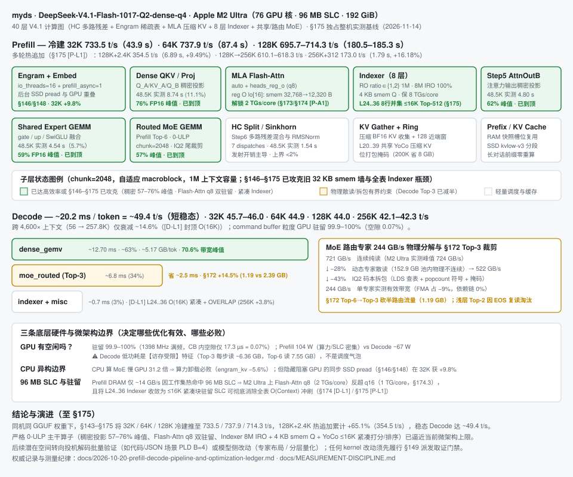

# myds: Apple Silicon Metal 推理引擎实验

> **来源与免责声明**：本项目**从 ds4 拷贝而来**，**全部内容由 LLM 编写**（DeepSeek / Gemini / Sol / Opus），
> 唯一目的是让它在 **M2 Ultra · 192 GB** 上更好用。
>
> *Origin & disclaimer: copied from ds4; wholly written by LLMs (DeepSeek, Gemini, Sol, Opus); just for better use on M2 Ultra / 192 GB.*

**当前 native engine 已完整实现 DeepSeek V4.1 文本与视觉计算图（HC、Engram、压缩 KV、indexer、Vision Encoder），并通过与 ds4 oracle 的逐位验收。**

验收依据与门禁规则记在[性能账本](docs/2026-10-20-prefill-decode-pipeline-and-optimization-ledger.md)的「方法论教训」与「已证否清单」两节；**性能现状、已采纳优化登记表（`§0.3`）与最新生产突破（`§143–§150`、`§172–§175`）以该账本为唯一权威记录**（`§0.0` 保留 2026-10-24 全链路普查快照，顶部摘要与 `§172–§175` 记录当前在产基线）。单元测试通过不等于真实模型逐位对齐，改动数值路径仍须过同等门禁。

**2026-10-28 分词优化（§107）**：ASCII 分类查表与请求内 BPE 临时内存复用已实现。
macstudio 实测英文/代码/多语言混合输入的 **CPU 分词耗时降低约 33–54%**，
完整 token ID 对照与独立 HF 参考通过；这是分词组件收益，未测新的整次推理吞吐。
原始样本、边界与复现命令见[分词性能记录](benchmarks/tokenizer_2026-10-28/README.md)，
账本记录见 §107；本地门禁为 `make test-tokenizer`。

**不相信这些数字？不用下载 362 GB 权重、也不需要 M2 Ultra。** 仓库自带可复现数据包与静态一致性门禁，几条命令即可复核：

```bash
make audit-ledger          # 核验登记数字可溯源 + 从原始 JSONL 重算 §105 表格与 6 条不变量
make verify-register-only  # 判定逻辑自检：能接受真数据、会拒绝假数据
make doc-check             # 严格校验文档引用的仓库路径与 make 目标全部存在
make adoption-check        # 校验账本 §0.3「在产」开关均存在于 include/myds_knobs_generated.h
```

流程、容差理由与「这套复现不能证明什么」见 [`docs/REPRODUCE-register-only.md`](docs/REPRODUCE-register-only.md)，
审计边界见账本 §106。

---

## 架构与耗时分布



一张图看完 40 层 V4.1 计算图里每个子层的职责、实测效率与 **§146–§175** 关键微架构突破（Engram 后台异步预读、Flash-Attention `q8` 寄存器驻留 `O` 解锁 `2 TGs/core`、Indexer `8M` `IRO` + `4 KB` smem `Q` + YoCo `≤16K` 紧凑打分/Top-512，以及 Decode `Top-3` 路由裁剪与 `O(16K)` 紧凑索引将单步耗时压至 **`~20.2 ms/tok`**）。**图中全部数字均对齐[性能账本](docs/2026-10-20-prefill-decode-pipeline-and-optimization-ledger.md) `§0.3` / `§172–§175` 唯一权威基线。**

---

## 实测性能

- **硬件**：Mac Studio，Apple M2 Ultra（76 核 GPU，**96 MB SLC**），**192 GB 统一内存**（Apple 标称 192 GiB = 十进制 206 GB，Metal 可用上限 201.9 GB），统一内存理论带宽 800 GB/s（实测峰值 724–799 GB/s）。
- **系统**：**macOS 27.0.1 (26A434)**（早期 2026-10-05 复现包测于 macOS 26.5.2）。
- **模型**：`DeepSeek-V4.1-Flash-1017-Q2-dense-q4-imx-cliecy.gguf`（文件 362.14 GB，其中 56% 为稀疏 `pread` 的 Engram 表；常驻 wired ~148.4 GB）。
- **测量口径（§173–§175 现行生产基线）**：通过 `tools/with_prod_guard.sh` 停产**独占整机**、`temperature=0`、`max_tokens=256`、无并发；保持生产配置（`MYDS_PREFIX_CACHE=1`、`MYDS_PLD=1`、`MYDS_PREFILL_ATTN=auto`、`MYDS_ATTN_HEADS_MODE=q8`、`MYDS_INDEXER_BATCH_FLOATS=8388608`、`MYDS_INDEXER_RO_SMEM_Q=1`、`MYDS_INDEXER_DECODE_COMPACT=1`、`MYDS_INDEXER_PREFILL_COMPACT=1`、`MYDS_MOE_DECODE_TOPK=3`、`MYDS_ENGRAM_IO_THREADS=16`）。冷启动使用台账真实语料（`benchmarks/register_only_2026-10-27/prompts/p32k_ab__v0.txt` 等同源拼接语料）并加唯一 nonce 前缀保证 `cached_tok = 0`（测量纪律见 [`docs/MEASUREMENT-DISCIPLINE.md`](docs/MEASUREMENT-DISCIPLINE.md)）。

### Prefill（§174 / §175 在产基线，2026-11-14）

#### 1. 冷启动 Prefill（`cached_tok = 0`，`temp=0, max_tokens=256`）

| 场景（真实语料） | 输入 Tokens | **吞吐（t/s）** | **TTFT / 耗时** | 对照说明 |
|---|---:|---:|---:|---|
| **32K 冷建**（3 样本中位） | 32,234 | **733.5**（§175 单测 733.7） | **43.9 s** | 较 10 月基线 `641.3 t/s (49.9 s)` 省 **6.0 s (+14.4%)** |
| **64K 冷建** | 64,483 | **737.9** | **87.4 s** | 矩阵注意力 `q8` 双驻留 + `8M` `IRO` 峰值区 |
| **128K 冷建** | 128,932 | **695.7–714.3** | **180.5–185.3 s** | 较 §172 末 `549.9 t/s (234.4 s)` 累计省 **49–54 s (+26.5%–29.9%)** |

#### 2. 多轮对话热追加与超长续填（`MYDS_PREFIX_CACHE=1`，§174 + §175 `[P-L1]`）

| 场景 | 命中前缀 `cached` | 新增 `prefill_tok` | **吞吐（t/s）** | **耗时** | 收益归因 |
|---|---:|---:|---:|---:|---|
| **`128K + 2.4K` 多轮热追加**（3 样本中位） | 128,512 | 2,440–2,444 | **354.5** | **6.89 s** | §175 `[P-L1]` 较 §174 再提 **+9.49%**（省 0.66 s）；较 §172 末 `214.7 t/s (11.27 s)` 累计 **+65.1%** |
| **`128K → 256K` 超长续填** | 128,512 | 129,307 | **610.1–618.3** | **209.1–212.0 s** | 较 §173 `552.6 t/s (234.0 s)` 省 **22.0–24.8 s (+10.4%–11.9%)** |
| **`256K + 312` 超长热追加 prime**（3 样本中位） | 257,536 | 304–312 | **173.0** | **1.79 s** | §175 `[P-L1]` 较 §174 `149.3 t/s (2.08 s)` 再提 **+16.18%**（省 0.29 s） |

> **历史超长上下文容量参考（2026-10-24 / §102，旧 `vec + TILED` 口径，未重跑 §173–§175 新核）**：
> `200K` `489.5 t/s` (`408.5 s`) · `400K` `371.7 t/s` (`1076.1 s`) · `500K` `331.7 t/s` (`1507.1 s`，峰值 wired `178 GB`) · `600K` `243.4 t/s` (`2465.9 s`，`moe_chunks=8`，峰值 wired `184.9 GB`，正常完结)。当前生产 `MYDS_CTX_SIZE=1048576`、`MYDS_CHUNK_KEY_MAX=1048576`。

### Decode（`256 tok`，`MYDS_MOE_DECODE_TOPK=3` + `MYDS_INDEXER_DECODE_COMPACT=1`）

| 上下文总长 | 短稳态（~56 tok） | 32K | 64K | 128K | 256K |
|---|---:|---:|---:|---:|---:|
| **t/s** | **~49.4** | **45.7–46.0** | **44.9** | **43.9–44.0** | **42.1–42.3** |
| **ms/tok** | **20.2 ms** | 21.7–21.9 ms | 22.3 ms | 22.7–22.8 ms | 23.6–23.7 ms |

跨 **4,600 倍上下文**（`56 tok → 257.8K`）Decode 仅衰减约 **14.6%**：§174 `[D-L1]` 将 `L24/28/32/36` 单步索引扫描从 `O(Context)` 封顶在 `O(16,384)`，长上下文代价被严格约束在 Prefill。（若设 `MYDS_MOE_DECODE_TOPK=0` 回退满血 `Top-6` 严格 0-ULP，短稳态为 `~42.9–44.0 t/s`。）

### 物理边界与 2026-11 架构突围复盘（§143–§175）

2026-10-24 的效率普查曾确认三条底层硬件事实（以 16.8K prompt 为样本）：

| 疑问 | 实测 | 含义 |
|---|---|---|
| GPU 算子间有空闲气泡吗？ | 计算期 GPU 驻留 **99.9–100%**，1398 MHz 满频，104 W | 纯 GPU 算子间「消气泡 / 改小屏障」（`intra_idle` 仅 0.07%）无效 |
| CPU 计算能替 GPU 分担吗？ | CPU 算 MoE 慢 GPU **31.2 倍** | 把矩阵/MoE 算力卸载到 CPU 无效（但**消除 CPU 同步 I/O 阻塞 GPU** 有效，见下 ①） |
| 常规 GEMM 受 DRAM 带宽限制吗？ | Prefill 主体 DRAM **14 GB/s**，重度依赖 **96 MB SLC** | 稠密投影已在 57–76% FP16 峰值；真正可挖的是**低占用率内核、冗余全局读写与超长上下文 `O(N²)` 无效扫描** |

2026 年 10 月底曾据此得出「flash-attention 被 `32 KB` threadgroup memory 锁死、prefill 与 decode 均无两位数收益方向」的阶段性结论。**2026 年 11 月（§143–§175）在同一台 M2 Ultra、同一份 GGUF 权重上正面推翻了这一旧判断**，核心突破来自五步：

1. **§143–§150（Engram I/O 并发隐藏 + §149 内核身份纠偏）**：
   - `MYDS_ENGRAM_IO_THREADS=16`（decode `+1.4%`）配合 `MYDS_ENGRAM_PREFILL_ASYNC=1` 将 macroblock 入口原本同步阻塞 GPU `2.7 s` 的 SSD `pread`/解码移入后台线程（32K prefill `618.9 → 679.4 t/s`，**+9.8%**，严格 0-ULP）。
   - **§149 关键纠偏**：通过新增 `MYDS_ATTN_WHICH=1` 取证发现，§89.1 误把当时默认未启用的 `matrix`（`heads`）内核当成了生产默认运行的 `vec` 内核（`kernel_myds_flash_attn_vec_head_first_f16_dk512_dv512`），由此立下仓库硬纪律：**优化任何 kernel 前，必须先拿到它在生产配置下真实被派发的日志/计数器证据**。
2. **§172（`MYDS_MOE_DECODE_TOPK=3` 单步 Decode 路由裁剪，稳态 +14.5%）**：
   - 仅在 `n_tokens == 1` 自回归解码阶段将每层路由专家从 `Top-6` 裁至统一 `Top-3` 并重归一化（Prefill 保持完整 `Top-6` 0-ULP，与 prefix cache 100% 兼容），稳态 Decode 从 `42.9` 跃升至 **`49.1 t/s`（+14.5%）**；真题排雷否决了会导致 `temp=0` EOS 停机失效的浅层 `k=2` 方案，并通过 14 套评测集（含 `AIME 2026` `10/10`、`GPQA` `5/5`、`HLE` 64K 连续 6 小时近百万 token 拷机）验收。
3. **§173（`A-1` Indexer `register-only` 全范围放开 + `B-1` `MYDS_PREFILL_ATTN=auto` 矩阵注意力）**：
   - 修复 `src/myds_v41_gpu.c` 中两处潜伏的 `ratio=2` 硬编码，将严格 0-ULP 的 `register_only` 打分放宽至 `ratio∈{1,2}` 与 `1M` 上下文（配对 `batch_floats` `2M→4M`）；同时在长块启用 `kernel_flash_attn_ext_blk` + `simdgroup_float8x8` 矩阵注意力（128K 冷建 **+22.2%，省 42.6 s**；`128K+2K` 热追加 **+37.4%**）。
4. **§174（`[P-A1]` 寄存器 `O` 击穿 `32 KB` smem 墙 + Indexer `[P-I1]`/`[P-I2s]`/`[D-L1]`，对 §173 严格 0-ULP）**：
   - **`[P-A1]` `MYDS_ATTN_HEADS_MODE=q8`**：利用 `V` 列块在 simdgroup 间正交的不变量，将 `O` 累加器从 `16 KB` threadgroup memory 移入寄存器 `lo[16]`，使 `heads` 内核 smem 从硬顶 **`32,768 B` 直降至 `12,320 B`**，在 M2 Ultra 上解锁 **2 TGs/core 双驻留延迟隐藏**（96 MB SLC 热命中下反超退回 1 TG/core 的 `q16`），正面打破 §89 的 `32 KB` smem 封锁；
   - **`[P-I1]`** `MYDS_INDEXER_BATCH_FLOATS=8388608` 配对二次因果面积均摊尾块（全模型 `IRO` 派发减半、覆盖率 **100%**）+ **`[P-I2s]`** `MYDS_INDEXER_RO_SMEM_Q=1`（`4,096 B` XOR-swizzled smem `Q` 压缩 16× 全局重读，严守 `4 KB × 8 = 32 KB` 保满 `8 TGs/core`）；
   - **`[D-L1]` `MYDS_INDEXER_DECODE_COMPACT=1`**：单步 Decode 后四层 `L24/28/32/36` 复用 `L20` 升序去重后的 `≤16,384` 候选集，将超长上下文索引耗时从 `O(Context)` 封顶为 `O(16K)`（`256K` Decode **+3.8%**）。
5. **§175（`[P-L1]` `MYDS_INDEXER_PREFILL_COMPACT=1` 长文 Prefill YoCo 紧凑管线，严格 0-ULP）**：
   - 针对长文 Prefill `L24/28/32/36`（`nc > 16384, pos0 ≥ 16384`），用无原子 SIMD 前缀和提取 8 行查询 tile 并集块表（`128K` 仅占全表 `12.6%`、`256K` 仅占 `6.4%–7.3%`），经 `4 KB` smem 紧凑 `register_only` 打分与批量 `≤16,384` 紧凑 Top-512（含同分/`<512` 分区双调重放），将单次子批扩至 `512` 行驻留 `96 MB SLC`（全局 scratch 仅净增 `+64 KiB`），使多轮热追加 `128K+2K` 再提 **+9.49%**、`256K+312` 再提 **+16.18%**。

> **2026-10-25 历史补充说明**：早期放宽 0-ULP 逐条实测的其他子项——专家进 `grid.z` **+0.82%**、专家权重截断 **+1.2%**、PLD 投机在无重复文本上 **−6.6%**——详见账本 §100/§101 及开关清单 [docs/ULP_SWITCHES.md](docs/ULP_SWITCHES.md)。

**一条工程铁律始终成立**：单份代码审计曾拿到的 5 倍提速（20 min → 4.1 min）来自修好 `MYDS_PREFIX_CACHE` 误用，而 §89/§149 的弯路来自「配置声称的值 ≠ 实际生效的内核」。为此仓库现已内置启动期 `verify_config_gate`（拒绝任何未被代码读取的 `MYDS_*` 拼写/废弃键）及 `make check-knobs` / `make check-knob-pairing` 静态门禁。

---

## 我们试过什么、为什么失败

**这一节比性能数字更有用。** 如果你打算优化这个引擎，先看这张表——这些方向已经有人用真实权重、真实 GPU 窗口测过了，
重复它们只会浪费时间。每一条后面都有明确的测量依据，细节在[性能账本](docs/2026-10-20-prefill-decode-pipeline-and-optimization-ledger.md)。

> **动手测之前先读 [`docs/MEASUREMENT-DISCIPLINE.md`](docs/MEASUREMENT-DISCIPLINE.md)。**
> 它回答「怎么保证测出来的数字不是假的」：`--config` 覆盖环境变量、三个让冷 prefill
> 悄悄变成热启动的缓存、A/B 两臂必须先证明不同、`gpu_gap` 不可回收、
> 0-ULP 通过不等于有收益。每一条都来自一次真实翻车，标了账本节号。

### MoE（14 个 0-ULP 候选 + 浅层 `Top-2` 有损候选）

| 尝试 | 结果 |
|---|---|
| 内层 8 元素改 `dot(float4,float4)` | 微基准 **−3.69%**，但**非 0-ULP**，端到端 **−0.3%** |
| 拆分标量累加器 | **非 0-ULP**（浮点不结合），**−0.35%** |
| 专家地址重排（局部性） | **地址分布影响 0%**（散开 1.01×、半散 0.90×） |
| 每 simdgroup 2 行（`NR0=2/NSG=4`） | **+77.9%** ⇒ 每 simdgroup **必须** 4 行 |
| 5,248 B signed4 组合表 | 组件 **0-ULP 通过**，但耗时 **+20.5~21.0%** |
| 热专家缓存 | 384 个专家全在用（745 万次选择覆盖 100%），**无冷专家可跳**；且 SLC 对同址复用 **零收益** |
| Decode 浅层 `Top-2` / 深层 `Top-3` 分层裁剪（§172.3） | 吞吐 `50.5 t/s`，但 **`temp=0` 贪婪解码削弱 EOS logit 引发 16K 自检复读死循环**（HumanEval 耗时暴涨 19×）⇒ **证否淘汰**（统一 `Top-3` 稳定通过 14 套基准） |

**MoE 的真实成本已量化**（三臂基准，同 dispatch 数、只差地址模式）：

```
721 GB/s  连续纯读（硬件峰值 724）
  ↓ −28%  散读（动态选路由专家，物理不连续）
522 GB/s
  ↓ −43%  拆包装（LDS 查表 + popcount 符号 + 掩码取反 + int8→float）
  ↓ −9%   FMA
244 GB/s  实测
```

### CPU 异构（四类场景全测）

| 方向 | 结论 | 关键数字 |
|---|---|---|
| CPU 卸载 prefill MoE | **+1.7%**，不值得 | CPU 慢 GPU **31.2 倍** |
| CPU 卸载 decode engram_kv | **−5.6%** | CPU 同步阻塞 1.43 ms，GPU 那 0.62 ms 本就在气泡里 |

### Attention、Indexer 与 dispatch（已证否路径）

| 方向 | 结论 |
|---|---|
| attention flash-decoding 拆两趟 | **−4.38%** |
| RMSNorm→GEMV 前序融合 | 证否 |
| 多头共享 K tile（`vec` 路径 H2/H4） | K-only 修订版 **0-ULP 通过**，但 concurrent 下退化 |
| 单头间接 KV 布局 | **0-ULP 通过**，但用时 **2.11 倍** |
| dispatch 边界气泡 | 实测 **intra_idle 17.3 µs = 0.07%**（GPU 在 command buffer 粒度 100% 驻留） |
| `simd_sum` 归约 / 屏障降级（§92） | 组件 **0-ULP 通过**，indexer **−3.05%**，但 prefill **−0.18%（噪声内）** |
| `heads` 矩阵注意力盲选 `q16`（16 头/TG，`24,640 B` smem，§174.3） | Apple M4 微基准 **+85%**，但在 **M2 Ultra（96 MB SLC）上因退回 1 TG/core 反输 `q8`（2 TGs/core）−0.49%** ⇒ 跨芯片不可盲推 |

### 结构性边界（硬件、内存或模型约束）

| 方向 | 阻断点与最新进展 |
|---|---|
| `flash-attention` 提高每 TG 头数至 `Q=16` | **已部分攻克并定案（§174 `[P-A1]`）**：旧核把 `O` 放 smem 使 `Q=8` 顶满 `32,768 B`（1 TG/core）、`Q=16` 需 `60 KB` 不可编译；§174 将 `O` 移入寄存器后 **`q8` 降至 `12,320 B` 解锁 2 TGs/core 获显著收益**，而 `q16`（`24,640 B`）因卡在 1 TG/core 在 M2 Ultra 上反慢于 `q8` |
| 换 FP8/BF16 主模型 | **统一内存墙**：FP8 需 ~510 GB，机器只有 192 GB |
| DSpark 投机解码 | 最好 **11.1%** 接受率 × 3.04× 验证成本 ⇒ **净慢** |
| `MYDS_INDEXER_KEY_WINDOW` 滑窗截断（§98） | 虽提速 ~15%，但 needle 落出窗口即**静默编造答案** ⇒ **严禁进生产** |
| 多请求合批 | 单人顺序请求**无货可合**，且生产有单飞锁 |
| TP=2 双机 | 需采购设备 |
| 抬线程数超 448 | 实测无变化（早期数字来自同时改 nsg 常量，口径错误） |

### 关键已采纳里程碑汇总（§85–§175）

完整采纳与退役状态由账本 `§0.3` 维护，并由 `make adoption-check` 自动校验：

| 节号 / 提交 | 核心改动 | 实测收益（M2 Ultra 独占） | 数值契约 |
|---|---|---|---|
| **§85** | `MYDS_INDEXER_TILED=1`（256 对/TG 分块打分） | 48.5K prefill **−1.73%** | 严格 0-ULP |
| **§105** | `MYDS_INDEXER_REGISTER_ONLY=1`（首版浅层 32K `simdgroup_matrix` 打分） | 32K prefill **+4.35%**（593.1→618.9 t/s） | 严格 0-ULP |
| **§107** | ASCII 分类快路径 + 请求内 BPE 工作区复用 | CPU 分词耗时 **−33%~−54%** | Token ID 逐位一致 |
| **§146 + §148** | `MYDS_ENGRAM_IO_THREADS=16` + `MYDS_ENGRAM_PREFILL_ASYNC=1` 后台预读 | 32K prefill 累计 **+9.8%**（→679.4 t/s），decode **+1.4%** | 严格 0-ULP |
| **§172**（`3e5658e`） | `MYDS_MOE_DECODE_TOPK=3`（仅单步 Decode Top-3 重归一化） | 稳态 decode **+14.5%**（42.9→49.1 t/s） | Prefill 0-ULP；14 套基准验收 |
| **§173**（`7550c36`） | `A-1` `register_only` 放开 `ratio∈{1,2}` 至 `1M` + `B-1` `MYDS_PREFILL_ATTN=auto` | 32K **+5.4%**、64K **+9.8%**、128K **+22.2%（省 42.6 s）**、`128K+2K` **+37.4%** | `A-1` 严格 0-ULP；`B-1` FP32 矩阵归约 |
| **§174**（`2636f6f`） | `[P-A1]` `heads_reg_o` `q8`（`12,320 B`，**2 TGs/core**）+ `[P-I1]` `8M` 二次均摊 + `[P-I2s]` `4 KB` smem `Q` + `[D-L1]` `O(16K)` 紧凑解码 | 较 §173：32K **+2.8%**（733.5 t/s）、64K **737.9 t/s**、128K **+8.9%（再省 16.4 s）**、`128K→256K` **+10.4%**、256K decode **+3.8%** | 对 §173 严格 0-ULP（9/9 档 SHA256 全同） |
| **§175**（`194829e`） | `[P-L1]` `MYDS_INDEXER_PREFILL_COMPACT=1`（`L24..36` 8 行 tile 并集紧凑打分 + `≤16K` 紧凑 Top-512，子批 512 行） | 较 §174：`128K+2K` 热追加 **+9.49%**（354.5 t/s，省 0.66 s）、`256K+312` **+16.18%**（173.0 t/s，省 0.29 s） | 严格 0-ULP（10/10 档 SHA256 全同） |

---

## 已有算子与实验基础

- **围绕 DeepSeek V4 / V4.1 构建的算子基础**（已接入 V4.1 文本计算图）：
  - **RMSNorm** 归一化加速
  - **MLA (Multi-head Latent Attention)** 解耦多头潜在注意力与低秩压缩 KV Cache
  - **Decoupled RoPE** 解耦旋转位置编码
  - **DeepSeekMoE** 混合专家网络（Shared Experts 共享专家 + Top-K 路由专家，Sigmoid 门控与权重重整化）
  - **SwiGLU** 激活函数融合计算
  - **模型加载检查**：架构名称仅用于识别模型家族；另外检查必要操作和词表维度，遇到未实现的 HC、Engram、压缩 KV、indexer 会拒绝推理
- **Apple Silicon Metal 算子**：
  - 仓库包含从 `ds4` 迁移的 `.metal` 源文件；文件存在不代表相应模型步骤已接入计算图
  - 利用统一内存架构（Unified Memory）通过 `MTLResourceStorageModeShared` 实现 CPU 与 GPU 之间零拷贝
  - 运行时即时编译优化，原生发挥 M 系列芯片（M1/M2/M3/M4/M5 等）的最大能效
- **极简架构与近乎零依赖**：
  - 文本推理引擎仅由几个高内聚、低耦合的模块组成，不依赖外部第三方库（仅系统级 Foundation 与 Metal 框架）；
    视觉路径另用内置的 header-only `third_party/iris`（JPEG/PNG 解码，仅图片输入时用到）
  - 内置极简 GGUF v2/v3 解析器，支持 `mmap` 秒级映射大模型权重
  - 内置 merge-rank byte BPE、JoyAI 预分词、显式字节长度解码与 UTF-8 流式输出
  - `make` 构建本地程序与测试；另有独立 HF tokenizer 与 ds4 tensor 对照工具

### 一个不属于本仓库的运行时依赖

`tools/slim_dense_q4.py` （把 dense 权重从 Q8_0 压到 Q4_K）**需要 `libds4quants`**。
那个库是 Q4_K 量化内核的分发产物，不随本仓库发布，所以 **fresh clone 直接跑会报
找不到库**——这是预期行为，不是安装残缺。

两种供法：

```bash
# ① 显式指定
python3 tools/slim_dense_q4.py --in model-q8.gguf --out model-q4.gguf \
       --quants-lib /path/to/libds4quants.dylib

# ② 放到默认搜索位置之一
#   <repo>/ds4/gguf-tools/libds4quants.{dylib,so}
#   ~/Projects/ds4/gguf-tools/libds4quants.{dylib,so}
```

**没有纯 Python 回退实现**：Q4_K 的分块量化必须与推理内核逐位一致，
用 numpy 重写一遍只会得到“看起来对但和 kernel 不同”的权重。
报错信息会把所有搜索路径与两种供法都打出来。

---

## 项目结构

```
myds/
├── Makefile                          # 构建、测试、门禁与制品溯源规则
├── README.md                         # 项目架构、实测基线与使用文档
├── metal/                            # Metal 着色器源码（共 39 个 .metal + 1 个 LUT 生成脚本）
│   ├── argsort.metal                 # Top-K 双调分区排序与因果前缀归并
│   ├── bin.metal / concat.metal / cpy.metal / get_rows.metal / repeat.metal / set_rows.metal / sum_rows.metal / unary.metal
│   ├── dense.metal                   # 量化 GEMV/GEMM (Q8_0, Q4_K, Q2_K, F16, F32)
│   ├── dsv4_hc.metal                 # HC 多路残差（split / sinkhorn / 加权和 / RMSNorm）
│   ├── dsv4_kv.metal / dsv4_rope.metal # DeepSeek KV Cache 状态操作与解耦 RoPE
│   ├── dsv4_misc.metal               # V4.1 辅助算子、TILED 打分、[D-L1] Decode 紧凑打分/Top-512、[P-L1] Prefill 8 行并集紧凑打分/Top-512
│   ├── dsv41.metal                   # V4.1 专有算子（indexer / compressor / attention-out）
│   ├── flash_attn.metal              # Flash Attention 主核（[P-A1] heads_reg_o q8/q16 寄存器累加、vec_head_first、ext_blk、packed8）
│   ├── glu.metal / norm.metal / softmax.metal / topk_threshold.metal
│   ├── moe.metal                     # 量化 MoE 专家 GEMV / 路由 / 累加（iq2_xxs, q2_K, q4_K …）
│   ├── myds_chunk.metal              # 分块 prefill 的 chunk attention / compressor
│   ├── myds_indexer_register_only.metal # [P-I2s] 4 KB XOR-swizzled smem Q 复用 register-only Indexer 打分核（ratio 1/2，上限 1M）
│   ├── myds_q4_v41.metal / myds_iq2_v41.metal / myds_qkv_dual.metal / myds_v41_moe.metal
│   ├── myds_prefill_attention_indirect.metal / myds_prefill_attention_multihead.metal / myds_prefill_output_register.metal
│   ├── myds_steer.metal              # GLP 残差控制向量（Steering）注入算子
│   ├── visenc.metal                  # 视觉编码器算子
│   └── probe_*.metal / pureread.metal # 带宽、反量化与候选算子微基准探针（7 个）
├── include/                          # 头文件定义（共 36 个 .h）
│   ├── myds.h / myds_internal.h      # 推理引擎主接口与内部共享结构
│   ├── myds_knobs.h / myds_knobs_generated.h # 运行时开关注册表与自动生成清单（273 个键 + 指纹校验）
│   ├── myds_configfile.h             # myds.conf 配置文件早期解析器
│   ├── myds_debugstate.h / myds_trace.h / myds_sysstat.h # /debug/state、/trace 诊断状态与系统指标采集
│   ├── myds_metal.h                  # Metal GPU 运行时与算子声明
│   ├── myds_gguf.h / myds_tokenizer.h # 极简 GGUF 解析器与 DeepSeek BPE 分词器
│   ├── myds_server.h / myds_server_internal.h # HTTP 服务端与连接/队列内部接口
│   ├── myds_v41.h / myds_v41_decode.h / myds_v41_gpu.h / myds_v41_moe.h # V4.1 计算图 / Decode / GPU / MoE
│   ├── myds_engram.h / myds_kvdsk.h / myds_lowkv_policy.h / myds_snapshot_slots.h # Engram 读取与多级前缀/KV 缓存
│   ├── myds_dspark.h / myds_dspine.h / myds_dspine_capture.h / myds_pld.h # 投机解码（DSpark / DSpine / PLD）
│   ├── myds_steer.h / myds_steer_alpha.h / myds_loop_guard.h # 控制向量注入与复读保护
│   ├── myds_vispre.h / myds_visw.h / myds_visfwd.h / myds_vjob.h # 视觉：预处理 / 权重 / 前向 / 作业
│   └── myds_cpu.h / myds_moe_cpu.h / myds_log.h / myds_align.h
├── src/                              # 核心源码（共 41 个文件：35 个 .c、1 个 .m、2 个内部表 .h、3 个 .inc）
│   ├── main.c                        # CLI 入口、单实例锁、端口预检与启动期配置门禁（verify_config_gate）
│   ├── myds_configfile.c / myds_knobs.c # 配置文件加载、MYDS_* 读取追踪与指纹输出
│   ├── myds_debugstate.c / myds_debug_acl.c / myds_trace.c / myds_sysstat.c # /debug/state、/trace 与 CIDR+Token 鉴权
│   ├── myds_engine.c                 # 前向传播调度、前缀快照恢复与投机解码状态机
│   ├── myds_metal.m                  # Metal 运行时、PSO 缓存、Residency 保活与 GPU 算子分发
│   ├── myds_gguf.c / myds_tokenizer.c # GGUF mmap 映射（含分片拼接）与 ASCII 快路径 BPE 分词器
│   ├── myds_server.c / myds_http_io.c / myds_infer_queue.c / myds_proto_openai.c / myds_resp_store.c / myds_dsml.c # HTTP 服务端与协议栈
│   ├── myds_v41.c                    # V4.1 主计算图（HC / 压缩 KV / YoCo / 异步 Engram / 分块调度）
│   ├── myds_v41_decode.c / myds_v41_gpu.c / myds_v41_moe.c # V4.1 Decode、GPU 管线与 MoE 路由（含 Decode Top-K）
│   ├── myds_engram.c / myds_engram_cpu.c / myds_kvdsk.c # Engram 并行/自适应 pread 与低位 KV 磁盘缓存
│   ├── myds_dspark.c / myds_dspine.c / myds_dspine_capture.c # DSpark / DSpine 投机解码与特征采集
│   ├── myds_steer.c / myds_steer_alpha.c # GLP 控制向量加载与动态缩放
│   ├── myds_vispre.c / myds_visw.c / myds_visfwd.c / myds_vjob.c # 视觉编码全链路
│   └── myds_cpu.c / myds_moe_cpu.c / myds_log.c # CPU 算子与微秒级结构化日志
├── tools/                            # 部署、制品溯源、台账审计与基准复现脚本（deploy_artifact.sh、with_prod_guard.sh 等）
├── docs/                             # 性能总账本、测量纪律、0-ULP 开关清单与视觉设计文档
└── tests/                            # 单元/GPU 0-ULP/宿主门禁与回归测试（共 172 个文件：86 .c + 34 .m + 49 .py + 2 .sh + 1 .h，另含 images/）
    ├── test_gguf.c  test_tokenizer.c  test_tokenizer_workspace.c  test_engine.c  test_cpu.c  test_log.c
    ├── test_metal.c  test_v41_gpu.c  test_attention_vec.c  test_attention_policy.c  test_attention_heads_rego.m
    ├── test_indexer_decode_compact.c  test_indexer_prefill_compact.m  test_attn_indexer_overlap_host.c
    ├── test_indexer_register_only_runtime_host.c  test_indexer_register_only_publisher_host.c  test_indexer_register_only_host.py
    ├── test_qkv_fusion.c  test_decode_q8_contract.c  test_v41_router.c  test_moe_down_nsg.m  test_moe_shared3.c
    ├── test_engram.c  test_engram_pool_failures.c  test_kvdsk.c  test_anchor_slots.c  test_deeper_ssd.c
    ├── test_server.c  test_server_api.c  test_http_bytes.c  test_debug_state.c  test_debug_acl.c  test_trace.c  test_dsml.c
    ├── test_steer.c  test_steer_alpha.c  test_loop_guard.c  test_dspine_runtime.c  test_dspine_capture.c
    └── test_p1_regressions.c  test_kprof.c  test_metal_residency_lifecycle.c  test_teardown_order.c  test_visw.c
```

---

## 编译与测试

早期优化轮次验收摘要与后续全部候选记录（含 §85 `TILED`、§105 `register_only`、§146/§148 Engram、§172 `MOE_DECODE_TOPK=3`、§173–§175 矩阵注意力与紧凑 Indexer）均统一维护在[性能账本](docs/2026-10-20-prefill-decode-pipeline-and-optimization-ledger.md)的 `§0.3`（已采纳）与 `§0.4`（已证否）两节——**该账本是性能结论的唯一权威。**

测试关闭 profiler，冷启动对照确保 `cached_tok = 0`（保持生产 `MYDS_PREFIX_CACHE=1` 并使用唯一 nonce 前缀），每组预热后正式采样取中位。
基准固定 `temperature=0`、`top_p=1`、`top_k=0`、`min_p=0`、`repetition_penalty=1`、`seed=42`；greedy argmax 路径不读取采样随机数。
2026-09-29 的早期性能记录只作历史状态说明，**已明确不代表可用性能**，不作基线。

### 1. 编译项目与生成构建溯源

在项目根目录下直接运行：

```bash
make -j8 all          # 编译 bin/myds、bin/myds.metallib 及测试套件
make provenance       # 生成 bin/BUILD-INFO.json（记录 commit、编译标志、源文件指纹与产物 SHA256）
```

### 2. 运行单元测试套件

```bash
make -j8 test
make test-indexer-register-only-host   # Indexer register-only / prefill-compact 宿主门禁套件
make test-tokenizer                    # 分词器正确性与工作区复用回归
```

`make test` 会先自动执行 `make check-knobs`，随后编译并运行 C / Metal / Python 回归套件，涵盖：

1. **GGUF 模型解析器测试套件 (`bin/test_gguf`、`bin/test_gguf_bounds`、`bin/test_gguf_split`、`bin/test_gguf_byte_split`)**：
   - [x] GGUF v2/v3 元数据提取、32 字节对齐 `mmap` 映射、分片拼接与畸形越界防护
   - [x] **DeepSeek V2 & V3 架构拦截校验**（严格拒绝 legacy V2/V3 模型）

2. **DeepSeek BPE 分词器测试套件 (`bin/test_tokenizer`、`bin/test_tokenizer_workspace`)**：
   - [x] 词表加载、BOS/EOS 识别、ASCII 快路径 Byte BPE、JoyAI 预分词、`<0xHH>` 回退与工作区复用

3. **Metal GPU 核心算子与 V4.1 严格 0-ULP 套件 (`bin/test_metal`、`bin/test_v41_gpu`、`bin/test_attention_heads_rego`、`bin/test_indexer_decode_compact`、`bin/test_indexer_prefill_compact`)**：
   - [x] RMSNorm / SwiGLU / Decoupled RoPE / MoE Router & Sum / Q8 & Q4 GEMV 精度与边界校验
   - [x] `[P-A1]` `heads_reg_o`（`q8` / `q16` vs `smem`）PSO 零寄存器溢出与多长度/掩码逐位 `0-ULP`
   - [x] `[P-I2s]` `register_only` `4 KB` XOR-swizzled smem `Q` vs `0 B` / `TILED` 逐位 `0-ULP`
   - [x] `[D-L1]` 单步 Decode 与 `[P-L1]` 批量 Prefill `≤16,384` 紧凑打分 + 紧凑 Top-512（含分区内/边界同分与 `<512` 稀疏尾双调重放）逐位 `0-ULP`

4. **HTTP 服务端、协议栈与诊断鉴权测试套件 (`bin/test_server`、`bin/test_server_api`、`bin/test_debug_state`、`bin/test_debug_acl`、`bin/test_trace`、`bin/test_dsml`)**：
   - [x] `/responses`、`/chat/completions`、`/health`、`/v1/models` 流式 SSE 与非流式 JSON 协议对齐
   - [x] `/debug/state` 与 `/trace` 的回环/CIDR + Token 双重访问控制及原子计数器导出

5. **微秒级结构化日志测试套件 (`bin/test_log`)**：
   - [x] 日志级别过滤 (DEBUG / INFO / WARN / ERROR) 与多线程并发安全性

6. **推理引擎、缓存与投机解码测试套件 (`bin/test_engine`、`bin/test_kvdsk`、`bin/test_anchor_slots`、`bin/test_pld`、`bin/test_dspark_*`、`bin/test_dspine_*`)**：
   - [x] Greedy / Temperature / Top-p 采样、跨 512-token 前缀快照恢复、KV 磁盘段校验、取消恢复与投机回滚

7. **CPU 数值回归 (`bin/test_cpu`)**：
   - [x] RoPE 在 288 组形状/位置/缩放/正反向组合下与原实现逐位一致

### 3. 自动化一致性与部署门禁（Verification Gates）

任何代码、配置或台账改动在合入与上线前均须通过以下静态/溯源门禁（全部退码须为 `0`）：

```bash
make check-knobs         # 校验源码实际读取的全部 MYDS_* 键与 include/myds_knobs_generated.h 完全同步
make check-knob-pairing  # 校验 bin/myds 开关指纹与舰队配置文件配对，杜绝未知/拼写错误环境变量静默失效
make claims-check        # 校验登记的性能数字与 benchmarks/ 原始测量记录逐项可溯源
make audit-ledger        # 运行 claims-check 并从原始 JSONL 重算复核台账 §105 统计表与不变量
make doc-check           # 严格审计 Markdown 文档中引用的仓库文件路径与 make 目标全部真实存在
make adoption-check      # 校验台账 §0.3 标记为「在产」的优化开关均存在于当前代码生成表
make deploy-check        # 校验 bin/BUILD-INFO.json 与源码树指纹、二进制/metallib SHA256 一致且无脏构建路径
```

运行可复现的算子与合成模型基准：

```bash
make bench
```

其中 `bench_metal` 在同一进程比较逐 token 与批量 GEMV，并检查逐位一致；
`bench_synthetic` 生成小型 MLA + MoE GGUF，测量真实加载、预填充和解码路径。
合成模型用于验证调度开销，真实模型性能请使用 `tools/with_prod_guard.sh` 独占窗口或 `tools/bench.sh`。

---

## 快速上手

### 命令行生成

以下展示 CLI 接口：

```bash
./bin/myds -m /path/to/deepseek.gguf -p "你好，请介绍一下你自己。"
```

### 交互式对话模式

如果未指定 `-p` 参数，`myds` 会自动进入交互式对话模式：

```bash
./bin/myds -m /path/to/deepseek.gguf
```

### HTTP 服务器模式 (OpenAI 兼容 API)

`myds` 内置 POSIX HTTP 服务端。只有模型加载通过后才会启动监听：

```bash
# 默认只监听 127.0.0.1（服务端没有鉴权）。
./bin/myds -m /path/to/deepseek.gguf --port 8080 --alias myds

# 要对外提供服务，必须显式指定 --host，并在前面放一层带鉴权的反代：
# ./bin/myds -m ... --port 8080 --host 0.0.0.0 --alias myds
```

> ⚠️ `--host` 只接受 IPv4 点分十进制地址（`127.0.0.1` / `0.0.0.0` / 具体网卡 IP）。
> 传主机名（如 `localhost`）会**拒绝启动**——旧版会默默退回监听全部接口。

支持的标准端点：
- `GET /health`：服务健康检查
- `GET /v1/models`：获取已加载的模型列表
- `POST /v1/responses` 或 `/responses`：原生支持 OpenAI Responses API 格式，完整支持流式 SSE (`event: response.output_text.delta`, `response.completed` 等) 与非流式 JSON (`output` 消息数组)
- `POST /v1/chat/completions` 或 `/chat/completions`：支持标准 OpenAI Chat Completions 协议（流式 SSE 与非流式 JSON）
- 请求体参数兼容性：全面支持 `instructions`（系统指令）、`input`（消息数组或纯文本，自动展开 `input_text` 复杂结构）、`messages`、`max_output_tokens` / `max_tokens`、`temperature` 与 `top_p`

### 常用参数说明

```
Usage:
  ./bin/myds -m <model.gguf> [options]

Options:
  -m, --model <path>        Path to DeepSeek V4/V4.1 GGUF model (required)
  --config <path>           Load MYDS_* config file (repeatable, later overrides earlier & env)
  --port <port>             Run HTTP server on specified port
  --host <host>             Host to listen on (default: 127.0.0.1; no auth, use a proxied 0.0.0.0 only)
  --alias <name>            Model alias for API responses (default: myds)
  --vision <file>           Vision encoder GGUF (enables image input; omit = text only)
  -p, --prompt <string>     Prompt string (if omitted and no --port, starts interactive chat)
  -n, --max-tokens <int>    Max tokens to generate (default: 256, or MYDS_MAX_NEW_TOKENS)
  -c, --ctx, --ctx-size     Context window size (default: 4096, or MYDS_CTX_SIZE)
  --temp <float>            Sampling temperature (default: 0.7, 0.0 for greedy)
  --top-p <float>           Nucleus top-p sampling cutoff (default: 0.9)
  --seed <int>              Random seed (default: current timestamp)
  --thinking [on|off]       Enable thinking / reasoning mode (default: off)
  --pld / --no-pld          Enable / disable Prompt-Lookup Decoding
  --steer-vector <path>     Path to GLP control vector GGUF (with --steer-alpha / --steer-mode)
  --print-config [-v]       Report MYDS_* keys read by this build (exit 2 on any unread key)
  --dump-config <path>      Write effective MYDS_* environment to a file
  --knob-fingerprint        Print this build's knob-name set fingerprint
  -h, --help                Show full help message
```

### 分片权重（split GGUF）

大模型常以多个文件发布。myds 支持两种形式，**直接指定任意一片即可**，无需手工合并：

| 形式 | 命名 | 每片是合法 GGUF？ | 何时用 |
|---|---|---|---|
| **按张量切**（llama.cpp `gguf-split`） | `model-00001-of-00005.gguf` | ✅ 是 | 没有单个超大的张量时 |
| **按字节切**（本仓库上传用） | `model.gguf.part01` + `model.gguf.parts` | ❌ 不是，拼起来才是 | 单个张量就超过托管方的单文件上限时 |

字节切法需要一个小清单 `<base>.parts`：

```
myds-split 1
parts 8
chunk 45268074496
total 362142629888
```

`chunk` 必须是页对齐的，且除最后一片外每片大小都必须等于它 —— 否则拼接会错位。
**缺片、缺清单、清单不自洽都直接拒绝加载**，不会静默读出错位数据。

> 为什么本仓库的权重用字节切：DeepSeek-V4.1-Flash 有两个 94.42 GiB 的
> engram 张量，按张量切也会产出超过 50 GB 的单片。

### 服务端防护与隐私（2026-10-25）

服务端**没有任何认证**，默认只监听 `127.0.0.1`。要对外提供服务，请放在带鉴权的
反向代理之后，并显式指定 `--host`。

| 环境变量 | 默认值 | 行为 |
| --- | --- | --- |
| `MYDS_MAX_BODY_MB` | `8` | 请求体上限（MB，取值 1..1024）。超限直接返回 **413**，不分配内存。旧版按 `Content-Length` 原样 `realloc`，一条 `Content-Length: 10000000000` 即可要求分配 10 GB。 |
| `MYDS_MAX_CONN` | `256` | 并发连接上限（1..4096）。超限返回 **503**。每条连接固定 4 MB 栈，无上限时几百条空闲连接即可耗尽内存。 |
| `MYDS_RECV_DEADLINE_S` | `120` | **整体**接收截止时间（秒，5..3600）。`SO_RCVTIMEO` 只管单次 `recv`，每 29 秒滴一个字节就能无限拖延；超时返回 **408**。 |
| `MYDS_CORS_ORIGIN` | `*` | 未设或 `*` 保持旧行为；`none` 不发送任何 CORS 头；其他值原样回显为该 origin。`CORS` 不是安全边界，真正的防护是监听地址与鉴权。 |

**启动时会把 fd 上限提升到 4096**（不超过系统硬限制）。`accept` 遇到 `EMFILE`
只退避 50 ms 后继续，不再退出服务器——旧版会把任何客户端开满 fd 当成致命错误。

#### ⚠️ 提示词会明文落盘

为了跨重启续跑 `previous_response_id`，服务端会把**完整的累积提示词文本**以
**明文**写入 `$HOME/.cache/myds/responses.idx`（可用 `MYDS_RESP_STATE` 改路径）。
文件权限为 `0600`、所在目录为 `0700`，但**未加密**。

这意味着你发过的全部对话内容会留在磁盘上，可能包含代码、密钥和个人数据，
并会被备份工具一并带走。不接受这一点的话：把 `HOME` 指向临时目录、
定期删除该文件，或让客户端不用 `previous_response_id`（每轮重发完整历史）。

### V4.1 推理工作区与流式传输

chunk attention 的 KV slab 和 mask 初始只分配窗口路径所需的 10.625 MiB。
压缩键容量仍覆盖配置的上下文；走 dense slab 且现有工作区不足时才扩容。
内存前缀快照在首次捕获对应槽位时分配，已分配的槽位继续复用。
compressed KV 与 index cache 保存已完成 BF16 舍入的上 16 位，读取时还原 F32；
计算中间量保持各自算子定义的精度与归约顺序。

> **注意区分「C 代码默认」与「生产 `myds.conf` 覆盖」**：通过 `--config` 加载的 `myds.conf` 会无条件覆盖同名进程环境变量（见 [`docs/MEASUREMENT-DISCIPLINE.md`](docs/MEASUREMENT-DISCIPLINE.md)）。启动时 `verify_config_gate` 会校验全部已设置的 `MYDS_*` 键均出现在 `include/myds_knobs_generated.h`（未识别键直接以退出码 `2` 拒绝启动）。

| 环境变量 | C 代码默认 | 生产 `myds.conf` | 行为与门禁说明 |
| --- | --- | --- | --- |
| `MYDS_PREFILL_ATTN` | **`vec`** | **`auto`** | `vec` 强制标量向量注意力；`matrix` 强制矩阵注意力（编码失败直接报错）；**`auto`**（§173 `B-1`）在满足 `use_gather && c_len≥32 && p0/ratio≥256 && n_comp≥512` 的长块派发 `kernel_flash_attn_ext_blk` + `heads` 矩阵注意力（FP32 寄存器累加，与 `vec` 差 `~1 ULP`），短块自动走 `vec`，缺 PSO/共享内存超限回退 `vec`。 |
| `MYDS_ATTN_HEADS_MODE` | **`q8`** | **`q8`** | §174 `[P-A1]` 矩阵注意力内核模式：`q8`（`kernel_myds_flash_attn_heads_f16_dk512_dv512`，寄存器 `lo[16]` 驻留 `O`，`12,320 B` smem，M2 Ultra 解锁 **2 TGs/core**）、`q16`（16 头/TG，`24,640 B` smem，1 TG/core）或 `smem`（旧 `32,768 B` smem 核，1 TG/core）；三模式输出逐位严格 0-ULP。 |
| `MYDS_INDEXER_REGISTER_ONLY` | **`1`（启用）** | 未设（沿用 `1`） | §105 / §173 `A-1` Prefill `simdgroup_matrix` Indexer 打分器：覆盖 `ratio∈{1,2}`、`n_tokens∈[8,2048]`、`n_comp∈(512,1048576]`、`pos0+n_tokens≤1048576`，与 `TILED` 严格 0-ULP。设为 `0` 回退 `indexscores_chunk`；非法值拒绝创建工作区。计数见 `myds_v41_gpu_indexer_register_only_counters()`。 |
| `MYDS_INDEXER_BATCH_FLOATS` | `max_comp>32768` 时 **`8388608`**（否则 `262144`） | **`8388608`** | §174 `[P-I1]` Prefill Indexer 评分/排序临时缓冲容量（合法显式范围 `65536..16777216`），配对 `indexer_group_len` 二次因果面积尾块均摊以消除 `<8` 行碎尾回退。 |
| `MYDS_INDEXER_RO_SMEM_Q` | **`1`（启用）** | **`1`** | §174 `[P-I2s]`：`1` 启用 `4,096 B` XOR-swizzled smem `Q` 复用（省 16× 全局 `Q` 重读，保 `8 TGs/core` 满驻留）；`0` 切回 `0 B` smem 内核；严格 0-ULP。 |
| `MYDS_INDEXER_DECODE_COMPACT` | **`1`（启用）** | **`1`** | §174 `[D-L1]`：单步 Decode 在 `n_comp > 16384` 时将 `L20` 选出的块升序去重，使后四层 `L24/28/32/36` 仅对 `≤16,384` 候选键紧凑打分与紧凑 Top-512（`O(Context)→O(16K)`，兼容 `MYDS_INDEXER_DECODE_OVERLAP=1`，严格 0-ULP）。`0` 关闭；计数见 `myds_v41_gpu_indexer_decode_compact_counters()`。 |
| `MYDS_INDEXER_PREFILL_COMPACT` | **`1`（启用）** | 未设（沿用 `1`） | §175 `[P-L1]`：长文 Prefill 在 `il > 20`（`L24/28/32/36`）、`ratio=1`、`n_comp > 16384`、`pos0 ≥ 16384`、`n_tokens ≥ 8` 时，构建无原子 8 行查询 tile 并集紧凑块表并执行 `4 KB` smem 紧凑 `register_only` 打分 + 批量 `≤16,384` 紧凑 Top-512（子批扩至 `512` 行，严格 0-ULP）。`0` 回退稠密打分 + 位图过滤 + 稠密 `topk_causal`；计数见 `/debug/state` `counters.indexer_prefill_compact`。 |
| `MYDS_INDEXER_TILED` | **`0`（关闭）** | **`1`** | §85 分块评分器（256 对/TG，严格 0-ULP）：当请求落在 `register_only` 门禁外（如 `n_comp ≤ 512` 或 `<8` 行）且 `n_tokens ≥ 8` 时作为 chunk 评分路径。 |
| `MYDS_MOE_DECODE_TOPK` | **`0`（满血 `Top-6`）** | **`3`** | §172 单步 Decode（`n_tokens == 1`）MoE 路由专家激活数裁剪与概率重归一化（Prefill 始终保完整 `Top-6` 0-ULP）。支持 `0`、`1..6`、40 位数字串或 `[def_k,]L1-L2:k` 语法；非法值报错拒绝。 |
| `MYDS_ENGRAM_IO_THREADS` | **`8`** | **`16`** | Engram 表 SSD `pread` 并发度：`1` 为串行，`2..16` 为每 context 独立常驻线程池，`auto` 为自适应控制器（§146 生产设 `16`，decode `+1.4%`）。 |
| `MYDS_ENGRAM_PREFILL_ASYNC` | **`1`（启用）** | 未设（沿用 `1`） | §148：当 `mb_len > 256` 时将 macroblock 的 Engram 表 `pread` 与解码放到后台线程与 GPU 并发执行（32K prefill `+5.9%`，严格 0-ULP）；设 `0` 恢复同步准备。 |
| `MYDS_ATTN_GATHER_MIN_KEYS` | `0` | 未设（沿用 `0`） | scratch 创建时捕获。压缩键数小于阈值时走 slab，达到阈值且 gather 开启时走 gather；合法范围 `0..chunk_key_max`。 |
| `MYDS_ATTN_GATHER` | 启用（`1`） | 未设（沿用 `1`） | 设为 `0` 关闭 gather，阈值不覆盖此开关。 |
| `MYDS_ATTN_VEC_HEAD_FIRST` | 启用（`1`） | 未设（沿用 `1`） | gathered prefill 的 `vec` attention 将 query/head 物理 grid 调换，保留每 head 归约。设为 `0` 用原排列；计数见 `myds_v41_gpu_attention_counters()`。 |
| `MYDS_PREFILL_INDEXER_PEEL` | 启用（`1`） | 未设（沿用 `1`） | `ratio=2` 索引层在绝对位置 0 剥离无可见压缩键的首行，其余行继续批处理；设为 `0` 恢复原回退路径。 |
| `MYDS_PREFILL_SKIP_DEAD_KV` | 启用（`1`） | 未设（沿用 `1`） | 后缀收缩时跳过第 21–39 层中无需保留窗口 KV 且无压缩器工作的前缀块；设为 `0` 恢复原调度。 |
| `MYDS_PREFILL_SHRINK_GRID_GUARDED` | 启用（`1`） | 未设（不触发） | 仅在 `chunk=512`、`shift=512`、`MYDS_PREFILL_ATTN=vec`、`gather-min=0` 等条件同时满足时按 512 网格收紧后缀重算范围；生产 `chunk=2048` + `auto` 自动保持原后缀锥。 |
| `MYDS_PREFILL_SHORT_END_SNAPSHOT` | 启用（`1`） | 未设（沿用 `1`） | prefix cache 开启且末尾位置 `p=prompt_tokens-1` 为 `4..1023` 时保存 RAM slot 0，重复短请求直接恢复末尾状态；`0` 关闭。 |
| `MYDS_QKV_FUSE_BF16` / `MYDS_QKV_FUSE_POST` | 启用（`1`） | 未设（沿用 `1`） | Decode Q8 QKV 投影合并 BF16 舍入写出，以及合并 Q/K RoPE、KV 量化与窗口写入；设为 `0` 恢复独立 dispatch。 |
| `MYDS_QKV_NR0` / `MYDS_LM_HEAD_Q8_NR0` | `4` / `2` | 未设（`4`） / `2` | 融合 Q8 QKV GEMV（`4` 或 `2`）与 LM-head plain Q8_0 GEMV（严格 `2` 或 `4`）每组输出行数。 |
| `MYDS_BATCH2_SPEC` / `MYDS_BATCH2_Q8_SHARED` | 关闭（`0`） / `0` | `0` / `1` | Greedy 双 token 投机验证总开关与 Batch2 output-B Q8 共享权重读取（`BATCH2_SPEC=0` 时不触发 Batch2 路径）。 |
| `MYDS_SPEC_SERIAL_PROBE` / `MYDS_SPEC_COST_SCHEDULER` | 关闭（`0`） | 未设（关闭） | 逐 token 投机对照探针与投机周期成本退避调度器。 |
| `MYDS_DECODE_METRICS` / `MYDS_QKV_CONCURRENT` | 关闭（`0`） | 未设（关闭） | Decode host 分项计时与单 token QKV/Indexer 局部 concurrent encoder 实验开关（生产使用全局 `MYDS_METAL_CONCURRENT=1`）。 |
| `MYDS_INDEXER_COMPACT_SCORER` | 关闭（`0`） | 未设（关闭） | 早期单步 Decode 稀疏写回稠密分数实验开关（仍扫稠密 Top-K）；现生产已被连同 Top-512 一起收敛为 `O(16K)` 的 `MYDS_INDEXER_DECODE_COMPACT=1`（`[D-L1]`）取代。 |
| `MYDS_INDEXER_TOPK_PREFIX_MERGE` / `MYDS_INDEXER_TOPK_NAN_FUSE` | `0` / `0` | **`1` / `1`** | 稠密 `argsort` Top-K 在 `≥16` 分区、`top≤512` 时裁剪中间归并输出，并在排序核内融合 IEEE 位 NaN 分区分类（严格 0-ULP）。 |
| `MYDS_MOE_IQ2_TAIL_CULL` | 启用（`1`） | 未设（沿用 `1`） | Prefill MoE IQ2 up/gate 尾 tile 跳过无有效 token 的半 tile；设为 `0` 恢复原 kernel。 |
| `MYDS_SSE_DRAIN_TIMEOUT_MS` | `1000` | 未设（沿用 `1000`） | SSE 完成时的整体排空期限（合法范围 `1..30000` ms）。 |

运行时诊断与原子计数器（`attention_counters`、`indexer_register_only`、`indexer_decode_compact`、`indexer_prefill_compact` 等）可通过代码 API 或受鉴权的 `GET /debug/state` 实时读取，用于严格履行 §149「必先验证实际派发路径而非仅看请求开关」的门禁要求。

生产 SSE 输出使用每请求独立的 FIFO writer。队列上限为 1 MiB，包含包头和正在发送的包；
入队不等待客户端 socket 或空闲队列容量。积压超限或断连会取消该请求，socket 在 writer
退出并 join 后关闭。尾部排空目前仍持有推理槽，等待受上述整体期限限制。

低位 KV 磁盘缓存改为窗口快照加共享 BF16 段：第一段为 `[0,1024)`，后续每段 512 token。
窗口文件为 `kvlow-v3-<identity>.bin`，段文件为 `kvsegments-v1-<identity>.bin`，
二者的总文件容量共同计入 `MYDS_KV_DSK_BUDGET_MB`。旧格式文件不再复用，也不会自动删除。
快照仅在相关段提交后发布；恢复校验位置、前缀哈希、布局和完整 payload 校验和，
引用的段被覆盖或损坏时返回缓存 miss。相同内容再次保存不重写窗口或共享段，但仍读取
并校验已有段。此存储改动不改变 `MYDS_KV_DSK_ASYNC` 的默认开关。

针对这些改动的本地门禁为 `make test` 与 `make test-indexer-register-only-host`。V4.1 GPU 回归分别运行默认 gather、关闭 gather、
显式阈值三种配置，并覆盖同一 command batch 内的路径切换、工作区扩容、BF16 缓存对照及 `[P-A1]` / `[P-I2s]` / `[D-L1]` / `[P-L1]` 全边界 0-ULP 校验。
这些测试不替代真实 GGUF 模型的 logits、吞吐与 TTFT 验收。

`make test` 还包含 QKV 两种行配置的非零逐位对照，以及 attention 的短块、carry、
F32/BF16 输入、子视图 canary、同一 batch 混用和缺 PSO 回退。独立完整模型计时工具
可用 `make bin/bench_phase` 构建；它不会由默认测试自动加载模型。

### 2026-10-05 测试、日志与测量复现

> **证据包不在本仓库。** 下文的 `$MYDS_EVIDENCE` 指向独立分发的原始测量证据（冻结的请求、补丁、
> 日志与汇总脚本），体积为数 GB，未随源码发布。不设该变量时，所有依赖它的步骤可跳过；
> 本仓库自带的 `tools/bench_reproduce.py` 与 `make test` 不依赖它。

本轮完整模型实测机器是 Apple M2 Ultra / 192 GiB / macOS 26.5.2，模型为
`DeepSeek-V4.1-Flash-Q2.gguf`，上下文容量 262144。本地 Apple M4 / 16 GiB
运行小规模 GPU fixture 和单元测试；完整模型吞吐数据来自 Mac Studio。
需要 Python 3、Clang、macOS SDK 和 Metal 编译工具；项目的
`tools/build_metallib.py` 负责生成 metallib。完整模型复测需要本机准备相同 GGUF。

#### 单元测试与日志

从仓库根目录运行，保存 stdout/stderr，并通过 `pipefail` 保留测试失败状态：

```sh
MYDS_REPRO_OUT="$(mktemp -d /tmp/myds-review-XXXXXX)"
set -o pipefail
make -B -j8 all bin/bench_phase 2>&1 | tee "$MYDS_REPRO_OUT/build.log"
make test 2>&1 | tee "$MYDS_REPRO_OUT/unit-tests.log"
make test-tail-init 2>&1 | tee "$MYDS_REPRO_OUT/tail-init.log"
python3 tools/protocol/selftest-summarize-final.py \
  > "$MYDS_REPRO_OUT/measurement-audit-selftest.json"
python3 tools/bench_reproduce.py verify
# 仅在基准测量快照检出上：python3 tools/bench_reproduce.py verify --check-source
```

`make -B` 强制重编译，避免复制源码或切换测量版本时复用时间戳较新的旧对象文件。
`make test-tail-init` 是独立 GPU 测试，不由 `make test` 自动执行；
`make build-tail-init` 只构建缺少可选 tail PSO 的真实 metallib fixture。
测量汇总脚本的 selftest 只处理 CPU 数据，验证有效样本及 18 种错误记录的拒绝行为。

| 测试入口 | 主要断言 |
| --- | --- |
| `bin/test_v41_gpu`、`--slab`、`--threshold` | gather/slab 选择、阈值、lazy 工作区、BF16 缓存、同一 batch 内路径切换；compact scorer 在 1..128k 行比较 dense scores/原 top-k IDs，覆盖全允许/屏蔽、有限及 `-INFINITY` 同分、尾块、反序 block IDs、子视图 canary、concurrent 依赖和缺 PSO 未写入回退；三种配置均在 `make test` 中执行。 |
| `bin/test_attention_policy` | matrix/auto/vec 策略、缺 PSO 和共享内存失败回退、恢复后的重试。 |
| `bin/test_attention_vec` | 非零 F32/BF16 逐位对照、短块和 carry、子视图 canary、head-first 成功与缺 PSO 回退及对应路径计数。 |
| `MYDS_QKV_NR0=4 bin/test_qkv_fusion`、`MYDS_QKV_NR0=2 bin/test_qkv_fusion` | 两种独立行配置、BF16 舍入边界、RoPE/量化/窗口写入、奇数输出行、别名与 copy 失败回退；局部 concurrent scope 比较实际投影形状的 QKV/HC/32-head Indexer，验证 opt-in/trace 门禁及失败后恢复两种设置；均在 `make test` 中执行。 |
| `make test-tail-init` | 真实缺 tail PSO 和必需 PSO 创建失败后的全状态清理、重复失败、恢复完整库及 lazy 初始化重试。 |
| `bin/test_engine`、`bin/test_p1` | 生成、前缀恢复与快照边界、缓存失败路径回归。 |
| `bin/test_server_api`、`tests/test_http_bytes.py` | FIFO SSE 输出、背压/断连取消、排空期限与实际 HTTP 字节协议；由 `make test` 执行。 |
| `bin/test_engram`、`bin/test_kvdsk`、`bin/test_metal` | LUT 数值、共享段提交/覆盖/损坏/budget、Metal 特化缓存与基础算子。 |
| `python3 tests/test_bench_reproduce.py` | 全 CPU：使用保存的真实 metrics 验证汇总，用 subprocess stub 验证输入/日志绑定、非 greedy 拒绝、超时/失败清理；由 `make test` 执行，stub 不运行 GGUF 或 Metal。 |

本轮原始日志收录于 `$MYDS_EVIDENCE/benchmarks/2026-10-05-optimization/validation/`：
`workspace-build.log`、`workspace-test.log`、`workspace-tail-init-test.log`、
`workspace-policy-retry-test.log`。`mandatory-pso-before-test.log` 是修复前故障复现，
其失败是预期证据；`mandatory-pso-after-test.log` 是修复后的通过记录。
打包时新增的测量入口 CPU 回归单独记录在 `reproduction-tool-test.log`，
探针构建与补丁检查记录在 `replay-tools/cpu-validation.json`。
本地 fixture 通过的范围是这些断言，完整模型的输出与性能另由下面的工具验证。

#### 完整模型每 token 测量

先在 Mac Studio 安排独占窗口：确认生产请求结束，暂停推理服务和其他 GPU benchmark，
完成后重启推理服务并检查 `/health`。
`tools/bench_reproduce.py run` 会检查已知推理/benchmark 进程与默认端口监听，
发现仍在运行时退出；服务暂停与恢复由窗口管理者负责。

```sh
MYDS_REPRO_MODEL="$HOME/.lmstudio/models/antirez/deepseek-v4.1-flash-gguf/DeepSeek-V4.1-Flash-Q2.gguf"
python3 tools/bench_reproduce.py run \
  --binary "$PWD/bin/bench_phase" \
  --model "$MYDS_REPRO_MODEL" \
  --request "$MYDS_EVIDENCE/benchmarks/2026-10-05-optimization/requests/normal.json" \
  --out "$MYDS_REPRO_OUT/candidate-normal"
```

输出目录必须是新的。`run-metrics.jsonl` 保存 metadata、模型加载信息、预热和三轮正式样本，
包括实际 token 数、原始 token 数组、输出字节哈希、逐 token 回调间隔；
`run.log` 保存引擎 stdout/stderr；`run-state.json` 保存完整 argv、显式环境、
二进制/metallib/请求 SHA、模型文件大小与 mtime、运行前后硬件/内存/swap 状态及退出码；
`run-summary.json` 仅在样本校验通过后产生。模型身份记录为文件元数据，未对整个 GGUF 做 SHA。
metadata 的 environment 额外记录 `MYDS_ATTN_VEC_HEAD_FIRST`、`MYDS_ATTN_GATHER_MIN_KEYS`、
`MYDS_PREFILL_ATTN`、`MYDS_QKV_FUSE_BF16`、`MYDS_QKV_FUSE_POST`、`MYDS_QKV_NR0`、
`MYDS_MOE_IQ2_TAIL_CULL`。每个样本含 `attention_paths`（本轮 attention 调用、gather/slab、
head-first 尝试/成功/失败/缓存回退、原 vec、matrix 及其回退次数）；出现回退时 stderr 另有一行提示。
Engram I/O 配置另记录 `MYDS_ENGRAM_IO_THREADS`、`MYDS_ENGRAM_NOCACHE`。
直接调用底层工具时，`MYDS_BENCH_STORAGE_COUNTERS=1` 在每次请求计时前后记录
`IOBlockStorageDriver` 的全局计数器；采集时间不计入请求耗时。这些是操作系统块设备
读计数，不能单独归因到本进程，也不能当作 NAND 流量。
`run-summary.json` 与 `compare` 输出 `attention_paths`，`run` 结束时打印 `attention_fallback`。
2026-10-05 证据由加入这些字段之前的 bench_phase 生成，样本中没有该字段，汇总显示为 `null`。

入口清除全部继承的 `MYDS_*` 环境，并显式设置 prefix cache、KV disk、phase profiler 为 0，
chunk=512、MoE chunks=9、suffix shift=512、residency keep-alive=86400。
`--env MYDS_NAME=value` 可以重复传入，例如 `--env MYDS_ATTN_VEC_HEAD_FIRST=0`；
缓存命中、profiler 和跳过计算的配置会被拒绝。三个请求样本为
`requests/short.json`、`normal.json`、`long.json`，分别实测 prefill 356、1830、7194 token。
默认生成上限 64；短请求实际 EOS 为 26 token，decode 分母因此为 25。

底层工具也可以直接调用：
`bin/bench_phase model.gguf request.json [repeats=3] [max_new_tokens=64] [max_seq_len=262144]`。
输出上限支持 32/64；温度、top-p、top-k、min-p、重复惩罚和 seed 在工具中固定为
0/1/0/0/1/42，greedy 路径不读取采样 RNG，请求 JSON 中的 sampling 字段不覆盖它。
prefill 口径为 `1000 * prefill_seconds / prefill_tokens`，最终 prompt token 在首次 decode
forward 消耗；decode 为 `1000 * (last_callback-first_callback) / (output_tokens-1)`，
不含首次 forward/TTFT。加载、HTTP 传输、队列等待不计入这两个指标。

#### Engram SSD 并行读取

> **2026-11-07 运行时与生产更新（§146 / §148 / §150）**：C 代码默认仍为 `8`（并新增 `MYDS_ENGRAM_IO_THREADS=auto` 自适应控制器），而生产 `myds.conf` 已提升为 **`MYDS_ENGRAM_IO_THREADS=16`**（decode `+1.4%`、32K prefill `+3.7%`）；同时 Prefill 新增默认开启的 **`MYDS_ENGRAM_PREFILL_ASYNC=1`**，在 `mb_len > 256` 时将 macroblock 的 Engram `pread`/解码移入后台线程与 GPU 重叠执行（32K prefill 再提 `+5.9%`，严格 0-ULP；设 `0` 可回退同步准备）。下文保留 2026-10-05 首版线程池的冻结复现记录。

默认使用 8 个读取线程；`MYDS_ENGRAM_IO_THREADS=1` 使用原串行读取；`2..16` 使用每个 context 独立拥有的
常驻线程池。只并行当前 token 的两张表共 48 行 raw `pread`，解码仍在调用线程按
原顺序执行。全部 worker 结束、读取与解码全部成功后才提交 history/position；
任意失败均返回错误，池初始化失败不会静默改变实际线程数。模型加载日志记录所选配置。

Mac Studio M2 Ultra 的同输入独占实测：Engram 冷首轮 CPU 路径由
1.197 降到 0.249 ms/token，完整模型冷首请求 prefill 由 4.339 降到
3.346 ms/token、decode 由 41.779 降到 37.460 ms/token。缓存热态存在调度成本：
普通 prompt 的 prefill 增加 0.059 ms/token、decode 增加 0.414 ms/token。
默认 8 线程优先降低 SSD 未命中时延；已知长期热缓存的负载可选择 1 线程。
这些是固定 prompt 的实测，冷首请求的 decode 已经过 prefill 暖页，不能解释为全部 lookup 都冷。

CPU 工具走真实 GGUF 的 `myds_engram_prepare_token`，包含 hash、派发、等待、读取和解码；
它不加载主干/GPU。`--tokens-bin` 接受 little-endian int32，`--text` 用模型分词器且
不额外加 BOS；完整 HTTP prompt 的精确输入导出工具见本轮协议。

```sh
make bin/bench_engram_io
python3 tools/run_engram_io.py --bench "$PWD/bin/bench_engram_io" \
  --model "$MYDS_REPRO_MODEL" --tokens-bin /absolute/path/to/tokens.bin \
  --output /absolute/path/to/new-results --order 1,4,8,8,4,1 --warm-runs 2
python3 tools/summarize_engram_io.py /absolute/path/to/new-results
python3 tools/test_engram_pool_failures.py --sanitizer address
python3 tools/test_engram_pool_failures.py --sanitizer thread
```

冷读候选样本使用同内容 APFS clone；每轮在模型/线程池初始化完成后，通过 stdin 闸门
采集读取阶段的设备计数器。不同 inode、`F_NOCACHE` 或应用层逻辑字节都不能独立证明冷读。
首轮与重复热态轮分别汇总，逐 token 行 ID、解码向量 hash、history 和跨配置一致性必须通过。
普通单元测试、线程/同步初始化故障注入、EINTR/正短读、并发、测量工具证据校验和
mock 独占窗口恢复测试纳入 `make test`。
完整模型与 CPU 读取的日志、复现步骤和结果在证据包的 `benchmarks/2026-10-05-engram-io/`，
含实测结论与复现协议两份文本。

#### 构建同轮基线并比较

同轮基线是本轮优化前的工作区，已含 causal mask 修复；使用已提交快照补丁恢复，
不能直接用旧部署版本代替：

```sh
MYDS_REPRO_BASE="$MYDS_REPRO_OUT/base-source"
mkdir "$MYDS_REPRO_BASE"
git archive 835d0f5161a0852e9021c2783b19847bd973a5d0 | tar -x -C "$MYDS_REPRO_BASE"
git -C "$MYDS_REPRO_BASE" apply --check \
  "$MYDS_EVIDENCE/benchmarks/2026-10-05-optimization/protocol/baseline-working-changes.patch"
git -C "$MYDS_REPRO_BASE" apply \
  "$MYDS_EVIDENCE/benchmarks/2026-10-05-optimization/protocol/baseline-working-changes.patch"
make -C "$MYDS_REPRO_BASE" -B -j8 all 2>&1 | tee "$MYDS_REPRO_OUT/base-build.log"
xcrun clang -O3 -Wall -Wextra -std=c11 -I"$MYDS_REPRO_BASE/include" \
  -c tools/bench_phase.c -o "$MYDS_REPRO_BASE/build/bench_phase.o"
xcrun clang "$MYDS_REPRO_BASE"/build/myds_*.o "$MYDS_REPRO_BASE/build/bench_phase.o" \
  -framework Foundation -framework Metal -lm -lpthread -o "$MYDS_REPRO_BASE/bin/bench_phase"
python3 tools/bench_reproduce.py run \
  --binary "$MYDS_REPRO_BASE/bin/bench_phase" --model "$MYDS_REPRO_MODEL" \
  --request "$MYDS_EVIDENCE/benchmarks/2026-10-05-optimization/requests/normal.json" \
  --out "$MYDS_REPRO_OUT/base-normal"
python3 tools/bench_reproduce.py compare \
  --base "$MYDS_REPRO_OUT/base-normal" --candidate "$MYDS_REPRO_OUT/candidate-normal" \
  --out "$MYDS_REPRO_OUT/normal-comparison.json"
```

每个版本使用独立进程，预热一次后正式三次。compare 重新校验原始记录，要求输入配置、
模型文件元数据、机器配置、全部 token 数组及输出字节哈希一致，再比较三轮中位数并保留
最小/最大值。实验 matrix 路径若改变输出，严格 compare 会失败，不能按严格一致优化报收益。
本轮长输入两轮变慢的数据在 `final-summary.json` 和
`head-first-long-validation.json` 中均保留；重新测试也应保留全部正式样本。

#### 层级归因、组件回放与已保存证据

| 文件/目录 | 用途与复现边界 |
| --- | --- |
| `optimization/raw/exclusive-20261005T022233Z/` | 主对照的六组 `*-metrics.jsonl`、引擎 `.log`、独占窗口事件 `window.jsonl`、服务恢复 `restore.log`。 |
| `optimization/raw/exclusive-20261005T023349Z/` | head-first 长输入补充对照，包含 host 诊断计数，独立于主对照。 |
| `optimization/protocol/summarize-final.py` | 对主窗口做 CPU 审计，验证完整结束、服务恢复、退出码、实际分母和输出，再生成 JSON/CSV。 |
| `optimization/replay-tools/recipe.json` | attention/MoE/decode 独立探针、实验 Metal 补丁、实际中间量采集、GGUF tensor layout 提取的源码来源、构建和运行命令。 |
| `optimization/component-provenance-audit.json` | 区分真实权重、真实中间量和合成输入；QKV 使用真实选定权重及合成非零 activation，decode IQ2 使用捕获的 prefill 末行。 |
| `optimization/replay-input-manifest.json` | 真实捕获文件的 SHA/大小。约 503 MB 的 activation 数据需按 recipe 重新采集，不包含在 Git 中。 |
| `phase/instrumentation.patch`、`phase/layer-profile.patch`、`phase/aggregate-layer.py` | 历史分层仪器及聚合脚本。GPU timestamp/counter 可用性与 profiler 扰动记录在 phase manifest；仪器结果用于归因，整体耗时采用关闭仪器的对照。 |
| `optimization/protocol/run-*.py`、`phase/run-exclusive.py` | 本轮执行过的历史窗口脚本，固定了当时的临时目录、fleet/model 路径、端口和生产 SHA。新窗口使用参数化 `bench_reproduce.py`；复用历史脚本前须准备其依赖并逐项核对现场配置。 |

上表中的 `optimization/`、`phase/` 分别指
`$MYDS_EVIDENCE/benchmarks/2026-10-05-optimization/` 和 `$MYDS_EVIDENCE/benchmarks/2026-10-05-phase/`。
仅复算已保存主对照数据，无需 GPU 或 GGUF：

```sh
python3 tools/protocol/summarize-final.py \
  $MYDS_EVIDENCE/benchmarks/2026-10-05-optimization/raw/exclusive-20261005T022233Z \
  --out "$MYDS_REPRO_OUT/saved-result-audit"
```

QKV 探针单独编译，`MYDS_QKV_BENCH_FUSED` 宏和 `--model` 均需提供，才能复现本轮融合对照：

```sh
xcrun clang -O3 -Wall -Wextra -Iinclude -fobjc-arc -DMYDS_QKV_BENCH_FUSED \
  tools/bench_qkv.m src/myds_v41_gpu.c src/myds_gguf.c src/myds_log.c \
  -framework Foundation -framework Metal -lm -lpthread -o bin/bench_qkv
MYDS_QKV_NR0=4 bin/bench_qkv --layout /path/to/tensor-layout.json \
  --model "$MYDS_REPRO_MODEL" --shader-dir "$PWD/bin" --layer 0 --samples 9 --reps 64 \
  > "$MYDS_REPRO_OUT/qkv-nr4.csv" 2> "$MYDS_REPRO_OUT/qkv-nr4.log"
```

layout 按 replay recipe 从同一 GGUF 提取。QKV 的 stdout 含启动信息及 CSV，历史文件虽用
`.jsonl` 后缀，审计按 CSV 处理；新复现采用 `.csv`。组件 probe 只给出该组件、该输入的计时，
不可将多个独立回放中位数相加后当作整层或整模型耗时。
`.gitattributes` 保留证据的原始换行，`bench_reproduce.py verify` 校验两轮证据 manifest；
`--check-source` 同时验证本次打包源码，基准是测量快照提交
`50a26cf`（*test(perf): add reproducible benchmarks and preserve Mac Studio evidence*）中的
源文件 SHA256；之后的提交（例如 attention 回退计数）会被报告为漂移，可用
`git diff 50a26cf -- <file>` 查看，证据 manifest 不随之改写。

> ⚠️ **2026-10-13 为公开做过一次历史重写**（清理家目录路径），**所有 commit SHA 已改变**。
> 本文中引用的两个基准提交旧哈希 → 新哈希：`afcc05c` → `50a26cf`；
> `f0a9c228` → `835d0f5`。（`$MYDS_EVIDENCE/benchmarks/**/manifest.json` 是冻结的证据，仍记录旧哈希，未改。）
服务部署后 SHA、模型或环境变化时，应另存新的结果目录。

## 视觉（图片输入）

支持图片输入（DeepSeek-V4.1-Flash-Vision），启动加 `--vision <编码器.gguf>`。
使用、原理、验证与**明确不做**的范围：见 **docs/VISION.md**。

**0-ULP 与非 0-ULP 开关的完整清单**（每个开关做什么、实测代价与收益、
日志如何确认生效、哪个单测覆盖它、以及那个单测**不能**证明什么）：
见 **[docs/ULP_SWITCHES.md](docs/ULP_SWITCHES.md)**。


---

## 来源与致谢（Provenance）

这个项目不是一个从零开始的实现。它**明确建立在若干 MIT 项目之上**，其中一部分是
源码级移植。下表是完整清单，**任何一条都不是"仅供参考"**——除了最后一行。

| 上游 | 许可 | 本仓库如何使用 | 声明位置 |
|---|---|---|---|
| **antirez/ds4** | MIT | 派生基础；`src/myds_engram.c`、`src/myds_vispre.c`、`include/myds_vispre.h`、`metal/visenc.metal`、`metal/dsv4_misc.metal` 中的 indexer 打分部分是**忠实移植**（算术次序与常量一字不改，以便逐层对拍） | `LICENSE` + 各文件头注释 |
| **ggml / llama.cpp** | MIT | 经 ds4 继承的量化布局、CPU 量化/点积逻辑、部分 kernel；另有直接移植：`src/myds_metal.m` 的 residency keep-alive（llama.cpp PR #17766，ggerganov）、residency set 未被引用时的处理（#26082）；`tools/score.c` 的 perplexity 分块协议复刻 | `LICENSE`（同上版权行）+ 代码内注释 |
| **IRIS**（antirez） | MIT | `third_party/iris/jpeg.h`、`png.h`（IRIS 的 JPEG/PNG 解码器，含 ds4 的解码上限补丁） | `third_party/iris/LICENSE`（独立全文）+ 文件内注释 |
| **DeepSeek** | 模型许可 | V4/V4.1 架构与 GGUF 张量约定 | `LICENSE` |
| **DeepInfer**（deepseek-ai） | **Apache-2.0** | **算法参考，非代码复制**。官方参考实现是 Python + tilelang（CUDA/Ascend），本仓库是 C + Metal，只借鉴了两个**算法设计**：① YoCo SWA Bounded Replay（`MYDS_YOCO_COMPACT` / `MYDS_YOCO_KEEP_TOKENS` 对应其 `yoco_mode` / `keep_tokens`）；② 结构化输出的 logit bitmask 过滤。算法本身不受版权保护，实现逐行为本仓库独立编写 | 各实现点注释 + 本表 |
| **deepseek-recipe**（deepseek-ai） | **MIT** | **参数口径对齐，非代码复制**：`max_tokens` 的官方分档（非思考 8192 / 思考 65536 / effort=max 131072，各自再被上下文压低）按其 `src/request/mod.rs` 对齐。数值是事实，不受版权保护 | `src/myds_server.c` 注释 + 本表 |
| vLLM / omlx / mlx | — | **仅思路参考**：一份优化规格文档综合了它们的做法，**没有代码复制**，因此不产生署名义务 | commit 描述 |

### 为什么 LICENSE 里没有单独的 "llama.cpp" 行

因为不需要：**llama.cpp 的 LICENSE 首行就是 `Copyright (c) 2023-2026 The ggml authors`**，
与本仓库 `LICENSE` 中的版权行**逐字相同**（2026-10-25 核对 upstream `LICENSE`）。
MIT 的义务是随分发附带版权声明与许可文本，这条已经满足。

同理，ds4 的 `LICENSE` 也是这三行（ds4.c authors / ggml authors / DeepSeek），
本仓库原样继承。

### 如果你要再分发

`LICENSE` 与 `third_party/iris/LICENSE` 必须一并保留。MIT 不要求公开源码，
但要求保留版权声明——删掉 LICENSE 再分发是不合规的。

### 关于 DeepInfer（Apache-2.0）的说明

本仓库**没有包含 DeepInfer 的任何源代码**，因此不构成 Apache-2.0 意义上的
derivative work（衍生作品）。Apache-2.0 的归属声明义务针对的是「复制、修改、
分发其源代码」；这里借鉴的是**不受版权保护的算法思想**。

但两件事仍然做了，因为它们是对的：

1. **明确致谢**：`src/myds_v41.c`（YoCo）、`src/myds_engine.c`（bitmask）、
   `include/myds_internal.h` 三处注释都写明「官方 DeepInfer 借鉴」。
2. **本表列出**：让读者一眼能看到算法来源，而不用去翻注释。

如果你认为这种程度的借鉴仍应附带 Apache-2.0 全文，可以提出——但按该许可证的字面
范围，纯算法参考不触发它。（对比：llama.cpp 的 residency 代码是**被移植**的，
所以它的归属声明是硬义务；这里不是。）

### 这份清单是怎么核出来的

不是凭记忆写的：`git log` 全文检索 `移植/adapted/ported from/取自/照抄` 与
`llama.cpp/ggml/vLLM/mlx` 得到候选，再逐个打开源文件确认是**代码移植**还是**思路参考**，
最后用上游 `LICENSE` 原文核对版权行。已知的移植点见上表；如果发现遗漏，
请开 issue —— 这类问题宁可多报。
